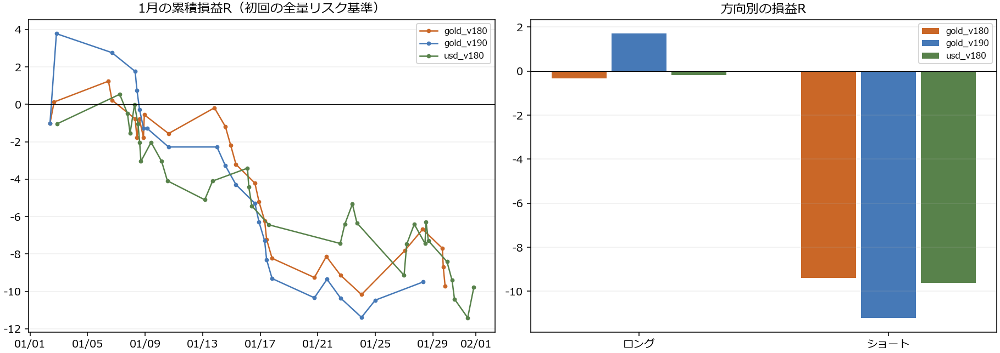

# 2025年1月のM5×M1：負けと上位足の分析

レビュー日：2026-10-27。直近に保存されていた2025年1月のXAUUSD+・USDJPYを対象にした。EA・パラメータを変更せず、追加のMT5実行もしない。結論は **「利確以前に伸びない入口が主な損失群。方向と上位足の往復環境を区別すべきだが、共通の禁止条件はまだ確定できない」**。

[負け30件・勝ち8件のM1/H1画像一覧](cases/index.html) ／ [H1全体図](figures/h1_overview.png) ／ [全131取引の特徴量](all_features.csv)

## 対象と実績

| 銘柄・EA | 保存期間の末尾 | 1月の完了取引 | 勝／敗／同値 | 合計R | 金額PF | 最大連敗 |
|---|---|---:|---|---:|---:|---:|
| XAUUSD+ v1.80 | 1/30 03:01 | 28 | 8／20／0 | −9.707 | 0.506 | 9 |
| XAUUSD+ v1.90 | 1/28 11:54 | 23 | 4／18／1 | −9.499 | 0.445 | 8 |
| USDJPY v1.80 | 3/27 23:57 | 32 | 11／21／0 | −9.794 | 0.582 | 5 |

金は1月末まで揃っていない。ドル円は1月が揃い、2月18件・3/27まで30件を比較に使える。v1.80は固定RR・①手前へのTP延長、v1.90は固定TPなし・2R開始の段階SL。直前のv1.91半分利確方式の成績ではない。ファイル名のv161という文字ではなくconfigのEAバージョンを採用した。

金v1.90の23セットアップはすべてv1.80と重なる。全体の131行は金28＋23＋ドル円80で、独立した131候補ではない。金の約定時刻・価格も版間で異なり、出口だけの厳密なA/B比較ではない。[元データとSHA](source_manifest.json)、[独立会計監査](integrity/summary.md)。

## 1. 大半の負けは＋1Rより前に起きている

| ログ | 負け取引 | 保有中に＋1R未到達 |
|---|---:|---:|
| 金 v1.80 | 20 | 19 |
| 金 v1.90 | 18 | 16 |
| ドル円 v1.80・1月 | 21 | 18 |

v1.90はnativeの保有中最大含み益を利用した。18敗には−0.00485Rのほぼ建値決済も1件含む。実質的な17敗のうち16件が＋1R未到達だった。したがって「＋1Rで半分利確」の発動前に負ける群が中心で、出口の修正だけでは主な損失群へ作用しない。

他2群の値は保存M1 Bid足の上限評価。売りの実行側Askとは異なる。約定・決済の境界分足には前後の極値が含まれる可能性を明記し、決済後の反発を保有中のMFEに混入させなかった。下限・上限・native値を別々に保存した。[経路分類](wave_exit/loss_paths.csv)、[手法と所見](wave_exit/findings.md)。

## 2. ショートに損失が集中する

| ログ | ロング | ショート |
|---|---|---|
| 金 v1.80 | 11件、−0.320R | 17件、−9.388R |
| 金 v1.90 | 9件、＋1.699R | 14件、−11.198R |
| ドル円 v1.80・1月 | 16件、−0.174R | 16件、−9.621R |

金のH1全体図では上昇過程に売りの負けが重なる。ただし、月全体を後から見た上昇を当時の判定条件には使っていない。各入口では確定済みH1/H4の傾き・構造・価格帯を別途計測した。

ここから「ショートを全部禁止」とは決められない。ドル円のショートは2月9件で＋0.315R、3月15件では−5.793R。方向と環境の組合せが問題で、単純な方向制限には別期間の比較が必要。

## 3. H1で往復して進まない環境は診断価値がある

ER12は、**直近の確定H1終値13個を使い、12回の値動きの最初から最後までの移動距離 ÷ 各回の移動距離の合計**で定義した。1に近いほど一方向、0に近いほど行って戻る。ここでの「12本」は観測できた確定足の本数で、週末を含めて必ず12経過時間という意味ではない。

既存の数値を見て最良値を探索せず、自然な比較用のER12≤0.25で往復が強い群を作った。

| 1月の対象 | ER≤0.25：件数／負け／平均R | それ以外：件数／負け／平均R |
|---|---|---|
| 金 v1.80 | 12／9／−0.376R | 15／10／−0.279R |
| 金 v1.90 | 10／9／−0.719R | 12／8／−0.109R |
| ドル円 v1.80 | 13／11／−0.847R | 19／10／＋0.064R |

金の各1件はH1観測不足で欠測。単純なH1上向き・下向きより「その時間足が実際に前進しているか」を加える余地はある。

**反証もある。** ドル円2月は低ER7件で＋0.427R、その他11件で−1.160Rと逆転した。金v1.80のショートでは低ER側の方が損失が小さい。低ERの金ショートが勝つ例も1/24にある。一律除外の採用根拠には足りず、現時点では診断指標。

[H1/H4全18条件と欠測](htf/README.md)、[ERの月別・方向別](htf/er12_month_direction.csv)。

## 4. ①の前のジグザグは、ドル円で有力な仮説になった

①始点より前の既知M5ピボット8個を使う。4高値・4安値の更新計6回のうち、①とは逆の元トレンドに沿う割合を計測した。ロング①なら下降してきた高値・安値、ショート①なら上昇してきた高値・安値が十分あるかを見る。①候補発生時点でまだ知り得ないピボットは使わない。

| ドル円 | 元トレンドに沿う更新が50%超 | 50%以下 |
|---|---|---|
| 1月 | 15件8勝、＋0.825R | 11件2勝、−6.978R |
| 2月 | 6件3勝、＋2.087R | 9件4勝、＋0.188R |
| 3月途中 | 12件8勝、＋4.614R | 14件5勝、−3.815R |

残りは必要な8ピボット不足で欠測。この所見は「元のトレンドをしっかり否定した①なのか、往復の途中に出た小さな①なのか」を区別する仮説に合う。ただし金では同じ改善方向にならず、多数の特徴量を見た後の発見でもある。銘柄共通の追加条件にはしない。

## 5. その他の観点と、採用しなかった条件

| 観点 | 観測したこと | 判断 |
|---|---|---|
| 既存H1_DIRECTION | WITH_H1群も3対象すべて負け越し。ドル円では1〜3月ともAGAINST群より平均Rが低い | 「H1と同方向だけ」に絞る根拠なし |
| H1 EMA20/50、傾き、直前足 | 単純順行でも損失。逆行群の方が良い比較もある | 単独の禁止条件にしない |
| H4方向 | 金の約半数でEMA50等の履歴不足 | 1月前半の結論には不十分 |
| H1抵抗・過去高安との重なり | ①と5%幅で近い群にも勝ちがあり、1R以内の抵抗も結果混在 | 過去線は候補。未突破か・時間的な古さ・現在の重要性は別評価 |
| ①の終点に近い入口 | ①の75%以上の位置から入る群は1月で弱い | ショート偏りが大きく、ドル円3月は逆転。距離だけでは禁止しない |
| SL幅/M1 ATR | 4倍超は1月とドル円3月で弱い | ドル円2月で逆転。SLを機械的に狭くする根拠ではない |
| ②が長時間継続 | 金では①より長い群が両版とも4件全敗 | 件数が少ない。古い候補の環境変化という仮説 |
| ①内部の往復量 | 小さい①も負ける。往復量と損失の単調な関係なし | 「きれいな①だけで解決」は未支持 |
| Fib、実体/ATR、延長①、転換種類 | 銘柄・月・出口方式をまたぐ安定した分離なし | 結果を見て条件を増やさない |
| 時間帯・スプレッド | 6時間のsource時刻区分で比較。金は複数区分とも負け。ドル円は勝ち側のspread/risk中央値がむしろ大きい | 「この時間だけ」「広いspreadだけ」が共通原因ではない |
| 連敗の並び | 金最大9/8連敗、ドル円5連敗。勝率を固定して順番をシャッフルしても同程度の連敗は珍しくない | 連敗の順番より低い入口期待値を優先して調べる |
| 約定・コスト | 金v1.90は46deal・23positionの会計一致。記録上手数料類は0 | 手数料ゼロでも負ける。一般の実口座コストへは外挿しない |
| 週末 | ドル円1/24の買いが1/27まで残り−2.802R | v1.80の持越しギャップ。v1.90/v1.91の週末前・24h決済とは分離 |

既存のH1_DIRECTIONは直近2高値・2安値がともに上昇／下降しているかの分類で、必要なピボットが揃わないときもH1_RANGEとなる。ERの往復度、EMAの方向、十分観測した真の横ばいは別物。初期不足を安全な相場と読み替えない。

経済イベントも[米雇用1/10](https://www.bls.gov/news.release/archives/empsit_01102025.htm)、[米CPI1/15](https://www.bls.gov/news.release/archives/cpi_01152025.htm)、[日銀1/24](https://www.boj.or.jp/mopo/mpmdeci/state_2025/k250124a.htm)、[FOMC1/29](https://www.federalreserve.gov/newsevents/pressreleases/monetary20250129a.htm)を一次資料で確認した。ただしブローカー時刻のUTC差が未確認なので「発表直前・直後」の機械分類は行っていない。同日で勝つ金ショートもあり、発表日の一律禁止とも結論しない。[参照日時](macro_sources.json)。

## 画像の見方

30敗＋8勝を[画像一覧](cases/index.html)に保存した。金v1.90の全18敗、ドル円の時系列11敗と最大ギャップ損失1件。対照は金の全4勝とドル円の最初の4勝。負けだけを見て「共通点がある」と思い込まないため勝ちも含める。

- [1/8 金ロング：H1往復中、保有中MFE0.57Rで損切り](cases/case_05.png)
- [1/16 金ショート：低ER以外でも負ける例](cases/case_12.png)
- [1/24 金ショート：低ERでも勝つ反例](cases/case_21.png)

MT5実画面のスクリーンショットではなく保存足からの再構成。足は終了時刻で配置し、灰色区間は約定後の結果説明。決済後の値動きは別表示し、保有中MFEへ加えない。①の位置時刻と、その終点をEAが知り得た時刻を分けて表示する。

## 次の検証の優先順位

出口は当面固定し、入口の環境を一つずつ検証する。金ではまずH1の往復度を診断表示し、低ERを見送る比較を1本だけ固定して別期間へ進めるのが候補。ただし今回のGold v1.80は低ER除外後でもマイナスなので、採用済み・利益化済みとは扱わない。ドル円の事前M5構造の一致率は別の銘柄別仮説として保持し、同時に複数フィルターを足さない。

今回の1月に合わせて閾値を探す、勝ちが増えるまで条件を重ねる、既存のH1ラベルをそのまま発注ガードにすることは行わなかった。全セルと反証を保存し、別期間で一貫しない案は採用しない。

## 検証と限界

H1/H4は完全なM5の12/48本を集約し、closed_at・known_atが入口以前のものだけを使用。未来データを切ったprefix再集約262回は全件一致。金のM1往復率も利用可能19件でEA記録と一致。元データは凍結し、hash監査を行った。[利用可能性監査](htf/availability.json)、[全特徴の定義](wave_exit/feature_definitions.md)。

最終照合163件PASS。独立3集計の131行とRが一致し、結合後は256列。画像38件・リンク・凍結元hash・EAの変更なしを確認した。[完了監査](completion_audit.json)。同義・相関の強い特徴も含むため、256個の独立した予測要因が見つかったという意味ではない。

金v1.90のdaytrade CSVにはreasonの未引用セミコロンによる33行の列ずれがあり、先頭4列＋末尾19列を固定してreasonだけ再結合した。初期SLはEXITの追従後SLから逆算せずFILL・初期risk固定ログで全件照合した。

USDJPYは口座通貨への金額評価係数が一定100という記録があり、銘柄仕様・テスター評価条件の再確認が必要。今回の特徴比較は初期金額リスクに対するRを中心に行い、金額・ロットを一般のFX条件へ外挿しない。多数の特徴・小標本・同日相関・重複版・未完成月があるため、条件付き平均の改善は新しいEAの成績を保証しない。
