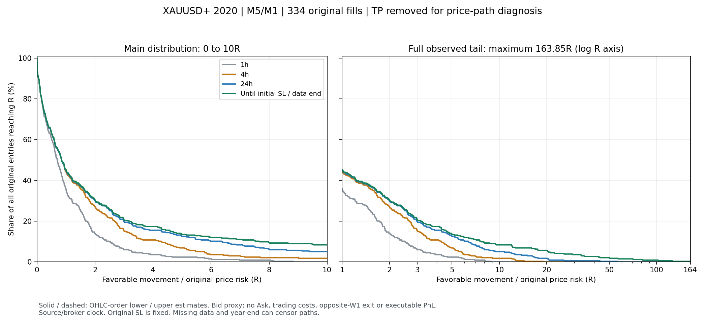
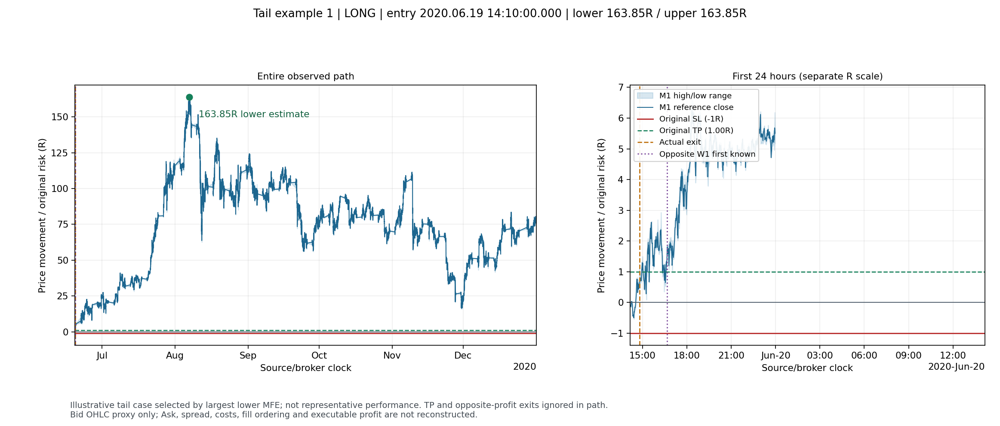

# 5Rで打ち切らない、元SLまでの最大到達R

**5R超の伸びは観測できた。ただし少数の長期保有例への集中が大きく、現在のEAで取れる利益とは異なる。** 2020年XAUUSD+・M5×M1の元334入口を固定し、保存済みM1参照OHLCで調べた。EA・テスターの再実行、取引設定・既存EAの変更はない。

## 全334件の到達数

1Rは実約定価格と元の初期SLの価格差。元SLに参照価格が最初に触れるまで追跡し、元取引にnative SL記録がある場合は、その実約定millisecondでも必ず打ち切った。SL未到達の5件は2020年末の最終保存足で打ち切った。Rの上限は設けていない。

| 到達水準 | 元SLまで／年末まで | 全334件に対する割合 | 最初の逆①が判明する前 |
|---|---:|---:|---:|
| 1R | 151 | 45.2% | 148 |
| 2R | 102 | 30.5% | 94 |
| 3R | 69 | 20.7% | 59 |
| 5R | 45 | 13.5% | 32 |
| 10R | 28 | 8.4% | 12 |
| 20R | 19 | 5.7% | 1 |
| 50R | 7 | 2.1% | 0 |

表は足内順序に関する保守側。楽観側でもこれらの到達件数は同じだった。1R未満の価格最大値が半数を超え、全体中央値は**0.851R**。最大値だけで全入口の質を判断できない。

逆①の列は「判明までに価格が伸びた範囲」であり、現在の「逆①後、費用込みでプラスなら決済」を厳密に再生した成績ではない。判明時にマイナスならその後も保有するため、この列を実際の最終利益の上限にしない。全期間列はこの決済を無視して追った潜在経路なので、実現利益としても扱わない。

## 保有時間も見ると違いがある

| エントリー後の観測窓 | 5R到達 | 10R到達 | 20R到達 | 50R到達 | 最大到達R |
|---|---:|---:|---:|---:|---:|
| 1時間 | 8 | 0 | 0 | 0 | 8.85 |
| 4時間 | 23 | 6 | 0 | 0 | 19.01 |
| 24時間 | 42 | 17 | 6 | 1 | 56.93 |
| 元SL／保存年末まで | 45 | 28 | 19 | 7 | 163.85 |

時計は元のbroker/sourceラベル。1/4/24時間は休場を含む経過時間であり、取引時間の累積ではない。各窓でも元SLが先ならそこで停止する。

最大163.85Rは、**2020.06.19 14:10 LONG → 2020.08.07 01:21の高値**で、頂点まで約48.47日だった。元のEAは6月19日14:48:05に約+0.981R（費用込み）で決済済み。最初の逆①は同日16:40に判明し、その前の最大の伸びは2.93Rだった。163.85Rを取るには、元の短期出口だけでなく長い途中逆行・swap・休場gapも扱う別の保有設計が必要になる。

次の最大例は[125.58RのLONG](figures/tail_case_02.png)、[102.36RのSHORT](figures/tail_case_03.png)。いずれも元TPでの決済より相当後の伸び。50R以上7件のうち5件は、同じ2020年8月7日の高値を最大点としている。別々の7回の独立した好機とは扱わない。長期保有を同時に重ねた資金・建玉制約も再現していない。

## 利確を遅らせる代償

元の勝ち144件のうち、参照経路で5Rへ届いたのは45件。残る99件は5R未達のまま元SL水準へ戻った（98件がSL到達足、1件がgap）。元の負け190件には、元SLより前に5Rへ伸びたケースはなかった。

したがって「大勝を残す余地がある」と「全件を5R以上狙いにすると利益が増える」は別の結論。大勝以外の既存利益を失う件数、逆①決済、保有中の逆行を含めた固定ルールの成績は未計測。今回から最良RRを選択せず、現行の既定値も変更しない。

## データと整合性

- [全334件CSV](data/positions_excursion.csv)：初期SL・元の実損益・各時間窓・元決済前・逆①判明前・上限なしの最大値と到達足時刻を保存。
- [集計とhash](data/summary.json)、[方向・四半期・元の勝敗別](data/groups.csv)、[実行前定義v1.1](PLAN.md)。方向別5RはLONG22/165、SHORT23/169。
- LONG/SHORT、SL到達足の順序、gap、部分入口足、native SL境界の合成10ケースPASS。別方式の[ベクトル極値照合](root_independent_audit.json)は全334件×上下2種類＝668値に差0、native SL190件を確認。EA source/EX5/17headersも変更なし。
- 初回Bid参照だけの出力では、実際のSHORT SL後の反発を19.78Rまで誤って含めたケースを検出。native SL境界を修復後、その例は0.0717Rへ訂正した。[修正前の記録](data_before_native_stop_correction/summary.json)は監査用に保存し、本文・図は修正後データだけを使った。
- M1参照OHLCには時々刻々のAsk／spreadがなく、特に元TP後のSHORTが本当に元SLへ未到達だったかを保証できない。上下限は参照足内の高安順序の範囲であり、約定損益の上下限ではない。全334件の入口はraw記録で分境界に一致。価格順序が不明なSL足は保守／楽観を分けた。
- 保存足355,232本。足のない区間276、最長4,575分（休場を含む）を[別CSV](data/source_gaps.csv)へ保存。欠落中のSL未到達を保証しない。元テスターも0%リアルティックの既知2020年であり、実ティック・未使用期間の証明ではない。
- 逆①の判明時刻は、同じペア・反対方向の新規 `WAVE1_PEAK_CONFIRMED` とログ順序から抽出。実保有中の13件のarm時刻と一致した。[イベント根拠](opposite_sources.json)。元決済後のイベントは元EAの候補生成に依存し、保有延長した別戦略の全候補を再現しない。

**判断：潜在的な大きな伸びは存在するが、出口の利益改善は未証明。今回は経路診断を完了し、EAの変更・最適化・追加テスター実行へ進めていない。**
