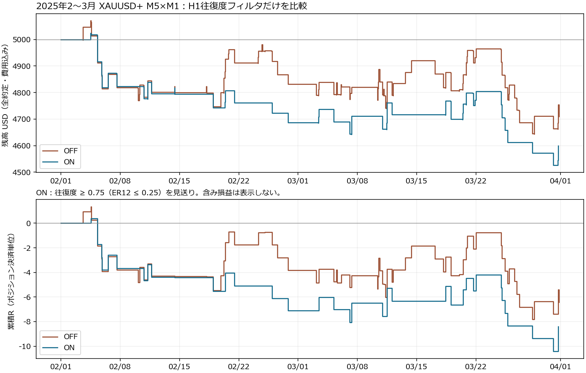

# H1往復度の固定比較：2025年2〜3月の結果

**今回のER12≤0.25の一律見送りは採用しない。** 1月に見られた改善は、この2か月合計では再現しなかった。ONは取引を減らしたが、合計R・実行1件平均・PF・最大連敗・DDが悪化した。閾値の再探索や別条件の追加、追加テストは行わず、標準OFFのままでこの比較を終了する。

実行データには両群共通の生成ティック補完がある。以下はその限界を持つ実行結果であり、純粋なリアルティック検証を通過したとは扱わない。

## 月別・期間全体

XAUUSD+、M5×M1、2025.02.01〜2025.04.01の連続した口座経路。月別はエントリー月に帰属し、その取引の部分決済と最終決済をまとめる。月初ごとに資金をリセットした比較ではない。費用込み、固定した初期全量リスクを1Rとする。

| 期間 | OFF件数 | ON件数 | OFF合計R | ON合計R | ON−OFF |
|---|---:|---:|---:|---:|---:|
| 2月 | 28 | 16 | −3.8191 | −7.1144 | −3.2952 |
| 3月 | 43 | 20 | −2.6005 | −1.2870 | ＋1.3135 |
| 合計 | 71 | 36 | −6.4196 | −8.4013 | −1.9817 |

| 項目・2か月全体 | OFF | ON |
|---|---:|---:|
| 勝ち／負け | 31／40 | 12／24 |
| 純損益 USD | −289.67 | −400.64 |
| 実行1件あたりR | −0.0904 | −0.2334 |
| OFF元71約定を共通分母としたR（除外=0） | −0.0904 | −0.1183 |
| ポジション単位PF・全費用込み | 0.8371 | 0.6334 |
| 勝率 | 43.7% | 33.3% |
| 最大連敗・最終決済順 | 5 | 6 |
| native最大equity DD | 9.31% / 474.42 USD | 10.69% / 539.73 USD |
| エントリーした日数 | 35 | 25 |
| 最終残高・開始5000 USD | 4710.33 | 4599.36 |

MT5の部分決済単位では取引数104→49、native PF0.85→0.65。元ポジション単位の本表の71→36、PF0.8371→0.6334とは集計単位が違う。純損益・残高は一致する。

上段は全約定・費用を含む残高、下段はポジションの最終決済時に計上する累積R。含み損益の曲線ではなく、equity DDはnativeレポートから取得した。

## 悪化の直接の内訳

OFFにあってONで除外された36件は、**20勝16敗、合計＋3.5584R／＋158.01 USD**だった。

- 除外した勝ち：＋18.2418R／＋829.91 USD。
- 回避した負け：−14.6833R／−671.90 USD。
- 特に除外LONG12件は10勝2敗、＋6.2006R。利益のある入口まで広く除外した。
- 保持35件はエントリー・初期SL・部分決済・最終決済の時刻/価格/数量比・決済理由・損益Rが同じ。
- ONのみ新規約定1件があり＋1.5767R／＋67.80 USD。

したがってR差は `−3.5584 + 1.5767 = −1.9817R`。保持分7件の資金連動ロット差による金額差−20.76 USDも含め、口座損益差は−110.97 USDとなった。1月の「3勝10敗を除いて改善」と逆の選別になった。

### 3月だけ損失が減った理由

3月の除外集合24件は12勝12敗、合計＋0.2632Rだった。間引きだけなら損益を削る方向だが、新規LONG①141の＋1.5767Rが加わり、全体差が＋1.3135Rとなった。

新規取引は3/7 06:44。OFFは先行LONG①140を保有していて、次の候補を`ACTIVE_SETUP_SAME_DIRECTION`で見送った。ONでは先行①140のER=0.02811を理由に除外し、候補枠が空いた。次の①141はER=0.35347で許可された。これを「3月では除外した群の質が悪かった」と読み替えない。

全体の差が出たエントリー日は26日、改善11日・悪化15日。一日ずつ外したR差の符号も一定ではない。比較の符号を救うために月・方向・日を後から採用条件に選び直さない。

## 原因について、何がわかったか

今回のフィルタ悪化は、計算・判定の不一致では説明されない。H1 ER全183観測を独立Decimal計算し、未来足・閾値判定差は0。**低ERの入口が、負けだけでなく勝ちにも多数現れた**ことが、今回の一律除外の損益悪化につながった。

往復度は終値の経路が相殺された程度を測り、細かな反転回数、ヒゲ、方向、抵抗線、転換後の伸びやすさは測らない。大きな一回のV字でも高くなる。この限界から、ユーザーが避けたい負け方をER一つだけで特定できたとは言えない。

エントリー後に伸びない損失群は残る。native記録の保有中MFEでは、OFF40敗中37件、ON24敗中23件が＋1R未到達だった。MFEは実約定・元SL固定の価格距離R、LONG Bid／SHORT Askの観測値。＋1R到達とraw部分決済のフラグは全107ポジションで一致した。独立エクスポートした全ティックの理論最大値ではない。どの①・上位足構造が負けを生むかの根本因果は、これだけでは確定しない。

| 方向 | OFF件数／合計R／平均R | ON件数／合計R／平均R |
|---|---|---|
| LONG | 31／−0.0005／−0.00002 | 20／−4.6244／−0.2312 |
| SHORT | 40／−6.4192／−0.1605 | 16／−3.7770／−0.2361 |

どちらも保持した側の平均は改善していない。1月と同様、合計損失や取引数だけで採用判断しない。

## 計算・実行・会計の検証

- 両方が3/31最終ティック23:57:54まで完了。8,306,849ティック、56,327生成M1バー。実際の確定M1/M5 CSVはknown_at・OHLCを含めバイト一致。
- 54入力はrun tag以外1月と一致し、OFF/ONの判断差はH1除外boolだけ。既存125ファイル、repo/凍結配備34ファイルはSHA不変。
- H1観測はOFF91／ON92。共通91判断の窓・時刻・価格・ERが一致し、ON追加1件を別に監査した。Decimal最大誤差5e−16、未来/形成中H1使用0、閾値差0。実行時純粋テスト45×2=90 PASS。
- native H1と完全12本M5代理系列には2/18 03:29の1判断で差がある。2/17 21時の3本だけの短縮セッションをnativeは含み、完全グリッド代理は落とすため。両方ER≤0.25で判定差なし。観測バー方式の窓は12〜61実時間。
- 全107ポジションでraw全量in/out、全費用込み会計、固定初期リスク、EXITのR、最終残高を照合。root会計925チェック、独立比較・会計67チェックを確認。
- 終了時の`CENSORED_AT_STOP`は両群同じ未発注候補①243。実ポジションは全て決済済みで、テスター終了強制決済の損益影響0。未発注の候補は将来の成立が不明のまま残す。

## データ・執行上の限界

HTMLは「100%リアルティック」の丸め表示だが、journalには**欠損6分＋不一致による破棄14分、計20分で生成ティックを使用**と明記されている。対象56,327分の約0.0355%。2/27・3/27の日別集計で、影響した正確な分はログから特定できない。別にlast price欠損2,741分でBidを使用した記録がある。両群の警告内容は同一だが、純粋なリアルティックだけの検証ゲートは**未達**。全ティック経路を独立監査したとも言わない。

警告日の保有ポジションを丸ごと差し引く参考集計でもONは悪化したが、実際に影響した分の切り分けや口座経路の再計算ではなく、補正済みバックテストとしては扱わない。

OFFでは3/20 01:00:29〜55、同一LONG①196の部分利確が`Market closed`で16回拒否された。01:01:00に部分決済に成功し、残りは01:19:36にSL決済。実現損益に含まれ、未決済ではない。ONはその取引を除外したため、この拒否はない。

TEMP内のterminal64.exe/metatester64.exeは実行後に不在で、現在のハッシュを再確認できない。起動前ハッシュと検証結果・native buildは保存済み。現在もあるEA EX5・入力・凍結repo資料は一致を確認した。原因不明の不在を補うために再配置・再実行はしていない。

## 判定と保存先

事前計画の「期間全体で相対改善せず／実行1件平均が改善しない場合は保留」に該当する。**この固定ER除外は標準採用しない。診断指標として保持し、標準入力はOFFのまま。** 閾値を探し直したり、赤字を救う条件を積み重ねることは今回行わない。1月の発見から選んだ比較であり、完全な未閲覧OOSとは呼ばない。2026 holdoutにも触れていない。

- [事前固定計画](../../PLAN.md)、[実行時の凍結計画](../PLAN.md)、[回収マニフェスト](../result_manifest.json)
- [全体JSON](performance.json)、[月別CSV](monthly_summary.csv)、[全107ポジション](positions.csv)、[約定の対応表](matched_positions.csv)
- [独立会計・差分監査](attribution/README.md)、[除外した36件](attribution/removed_off_fills.csv)
- [H1全行の計算監査](math/README.md)、[実行・データ品質監査](integrity/README.md)

再集計：`python tools/wave33_visual/h1_er_febmar_review.py`。これは凍結CSVを読むだけで、MT5は起動しない。
