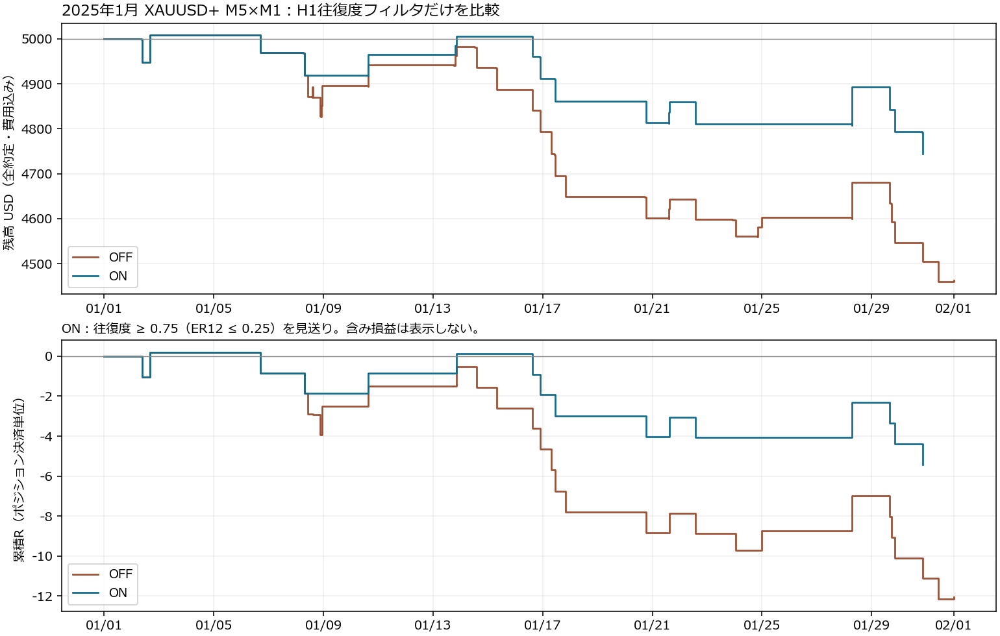

# H1往復度OFF/ON：2025年1月の結果

**損失は縮小したが、単独で利益が出る条件にはならなかった。標準設定への採用は保留する。** XAUUSD+、M5×M1、2025.01.01〜2025.02.01。現在の半分利確・段階SL・24時間決済を固定し、H1往復度の除外一つだけを比較した。追加の閾値探索・再実行はしていない。

## エントリー単位の成績

部分利確と最終決済を、元の一つのポジションにまとめた。利益・手数料・swap・feeを含め、損益Rは固定した初期全量の金額リスクを分母とする。

| 項目 | OFF | ON |
|---|---:|---:|
| エントリー数 | 29 | 16 |
| 勝ち／負け | 8／21 | 5／11 |
| 勝率 | 27.6% | 31.3% |
| 純損益 USD | −536.91 | −255.43 |
| 合計R | −12.0700 | −5.4151 |
| 実行した1件あたりR | −0.4162 | −0.3384 |
| OFF全29件を共通分母としたR（除外=0） | −0.4162 | −0.1867 |
| ポジション単位PF・全費用込み | 0.4126 | 0.5180 |
| 最大連敗・最終決済順 | 8 | 4 |
| native最大equity DD | 11.20% / 562.47 USD | 5.49% / 275.35 USD |
| エントリーした日数 | 18 | 13 |
| 最終残高・開始5000 USD | 4463.09 | 4744.57 |

金額損失は52.4%減った一方、取引数も44.8%減った。残した取引の平均もマイナスなので「負ける取引を減らした」と「利益を出せるEAになった」は別の判定になる。

MT5 HTML上の取引数は37→21、PFは0.43→0.52。部分決済を別の決済取引として数えるため、この表の29→16・PFとは集計単位が異なる。純損益は両方の集計で一致する。MT5の部分決済単位の勝率と、本表のエントリー単位の勝率を混ぜない。

残高は全約定・費用を反映し、下段Rはポジションの最終決済時点で計上する。含み損益の曲線ではないため、equity DDは画像から読み取らずnativeレポートを参照する。

## 何が変わったか

除外13件は**負け10件・勝ち3件**、OFFでの合計−6.6549R／−294.94 USDだった。残った16件は同じエントリー、初期SL、部分利確、最終決済の時刻・価格・数量比・決済理由・損益R。ONで新たに発生した約定は0件で、R改善はこの13件の除外だけで説明できる。

資金連動のロットは保持分7件で変わり、保持分の金額差は−13.46 USD。したがって実際の口座損益差は+281.48 USDで、除外した元の損失額294.94 USDと同一ではない。

| 方向 | 件数 OFF→ON | 合計R OFF→ON | 実行1件あたりR OFF→ON |
|---|---:|---:|---:|
| LONG | 13→7 | −2.7623→−0.1346 | −0.2125→−0.0192 |
| SHORT | 16→9 | −9.3077→−5.2805 | −0.5817→−0.5867 |

ロングの負け回避には差がある。ショートは合計損失こそ減ったが、残ったショートの平均は改善していない。H1の往復度は方向を見ないため、これだけでショートの根本的な負けを除けたとは言えない。

効果が生じたエントリー日は8日、7日改善・1日悪化。1/17がR改善の31.4%、上位3日で62.6%。影響する日を一日ずつ除いても改善符号は正だが、既に観察・探索した1か月の結果であり、独立したOOSや統計的な再現性の証明ではない。別の保存済みUSDJPY2月では悪化した反例も残る。

## 往復度の定義と検証

確定H1の終値13個を使用し、12差分から計算する。

`ER = abs(C12−C0) / sum(abs(Ci−C(i−1)))`

`往復度 = 1−ER`。ONのみ `ER≤0.25`、つまり `往復度≥0.75` で除外する。

これは終値経路の相殺度。細かな反転の回数、ヒゲ、値動きの大きさ、次の方向は測らない。一回のV字でも高くなるため、相場画像で見た「往復が多い」と完全に同じ意味ではない。窓は観測H1バー数で、休場をまたげば実時間は延びる。

- 記録78行＝両群39判断ずつを独立Decimal再計算。最大誤差5e−16、閾値判定差0。
- 両群の39判断で13終値・時刻・ERが一致。形成中・未来のH1混入0。
- 初期化時の純粋テスト45個×2群、計90チェックPASS。さらに独立Decimalの極端例も確認。
- 各群17/39窓は休場ギャップを含み、窓の実時間幅は12〜61時間。13観測バーを「直近12時間」とは呼ばない。
- 今回の全判断でnative H1は取得できた。欠測を許可する分岐は純粋テストで確認したが、実市場で欠測した観測例はない。
- 完全M5グリッドから作る旧H1代理系列と38/39窓は一致。初回だけnativeは開始前履歴を持つ一方、旧代理系列はウォームアップ不足。初回ERは0.470556で両方式とも許可となる。
- 1/20の部分セッション時間帯は、今回の判断窓に含まれなかった。その時間帯のnative/proxy一致は**未観測**のままで、確認済みとはしない。
- ONログはALLOW21／H1 SKIP13／他条件が優先する低ER5。今回のSKIP13件はOFFの実約定13件と対応した。ただしH1判定がbusy・週末・ロット制約より前にあるため、他のテストでもSKIP件数＝回避取引数とは限らない。

## 実行と会計の検証

両方が1/31末まで完了。MT5は100%リアルティックと報告し、両群4,010,784ティック・30,163生成M1バー。ティック代替生成・欠落・不一致警告は見つからなかった。実際の確定M1/M5出力は時刻・known_at・OHLCを含めバイト一致した。ティック全列を独立に出力した監査ではない。

native HTMLの入力54個は凍結presetと一致し、判断の差は除外boolのみ。run tagは別。既存125ファイルと凍結した配置34ファイルはSHA256不変。全45ポジションの全量in/outと費用込み会計、元リスク、EXITのR、最終残高が照合でき、未決済0件。

研究上の結論は**計算・比較の整合性PASS、戦略の採用は保留**。標準入力はOFFのままとする。次の条件追加・閾値変更・長期テストは今回の作業では行わない。2026 holdoutにも触れていない。

## 証拠と再集計

- [固定実施計画](../../PLAN.md)、[凍結時の計画](../PLAN.md)、[回収マニフェスト](../result_manifest.json)
- [集計JSON](performance.json)、[全45ポジション](positions.csv)、[OFF/ONの対応表](matched_positions.csv)、[日別差](daily_entry_attribution.csv)
- [独立会計・差分監査](attribution/README.md)、[除外した13件](attribution/removed_off_fills.csv)
- [独立H1計算監査](math/README.md)、[全行Decimal比較](math/decimal_all_rows.csv)
- [実行・データ整合性監査](integrity/README.md)、[52項目の検証](integrity/integrity.json)

EAを起動せず再集計するコマンド：`python tools/wave33_visual/h1_er_native_review.py`。旧診断の値やnative部分決済単位のPFと、このポジション単位の値を混ぜない。
