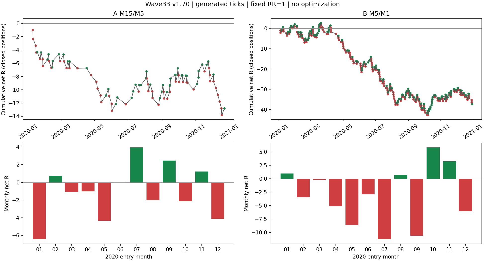

# Wave33 v1.70・2020年：連勝と連敗の違い

両時間足に連勝・連敗のまとまりはある。ただし、この1年から「連敗を予測して止めれば改善する」とまでは言えない。年間では両方とも負で、費用込みの平均勝ちが平均負けより小さい。まず勝敗数と利益の大きさを分けて見る必要がある。EA・RR・パラメータの変更、追加バックテスト、最適化は行っていない。

## 年間結果

XAUUSD+、2020.01.01〜2021.01.01、初期5,000 USD、RR1、リスク1%、①延長・逆①利益決済ON。A/Bは別々の口座計算で、合算ポートフォリオではない。

| 指標 | A：M15×M5 | B：M5×M1 |
|---|---:|---:|
| 完了取引 | 97 | 378 |
| 費用込み勝率 | 47.4%（46勝51敗） | 49.5%（187勝191敗） |
| MT5帳票PF | 0.75 | 0.81 |
| ポジションごとの純損益PF | 0.749 | 0.801 |
| 純損益 | -581.12 USD | -1,577.51 USD |
| 合計R / 平均R | -12.82 / -0.132 | -37.32 / -0.099 |
| 平均勝ち / 平均負け | +0.855R / -1.023R | +0.872R / -1.049R |
| 観測した平均損益幅での損益分岐勝率 | 54.5% | 54.6% |
| 最大有効証拠金DD（MT5） | 642.87 USD（12.85%） | 1,849.42 USD（36.27%） |
| 最大連勝 / 最大連敗 | 4 / 6 | 12 / 8 |

損益分岐勝率は今回の平均勝ち・負けを固定した計算であり、RRを変えても勝率が維持されるという予測ではない。Rの分母は各ポジションの実約定値から元SLまでの金額リスク。残高の複利計算とは単位が違う。

MT5のPFは符号別の約定損益、ここでの純損益PFはエントリー手数料・スワップも同一ポジションへまとめた損益から計算するため、Bの0.81と0.80は定義の差。[独立照合](native_integrity.md)は6,719チェックPASS、475取引すべての現金損益とRが一致した。未決済・テスター終了強制決済・EXIT欠落は0件。全12か月の足を確認した。



上段は実際の決済順の累積R、緑が純利益、赤が純損失。下段はエントリー月でまとめた合計R。月ごとの件数は異なる。

## 実際に続いた期間

| 組合せ・種類 | 最初のエントリー → 最後の決済 | 件数 | 合計R |
|---|---|---:|---:|
| A 最大連勝① | 7/21 08:20 → 8/3 13:15:02 | 4勝 | +3.02 |
| A 最大連勝② | 11/2 19:30 → 11/12 22:47:35 | 4勝 | +3.75 |
| A 最大連敗 | 12/3 12:25 → 12/18 13:55:30 | 6敗 | -6.09 |
| B 最大連勝 | 10/8 06:06 → 10/19 21:48:25 | 12勝 | +9.78 |
| B 最大連敗 | 7/31 15:45 → 8/7 17:56:03 | 8敗 | -8.17 |

すべて2020年のブローカー/ソース時刻。勝敗はTP/SL名称ではなく、費用込みの実現純損益で判定した。ゼロ損益なら連続を中断する定義だが、今回はゼロ0件。保有の重複も0件。3連続以上のまとまりはAが6連勝区間・7連敗区間、Bが23連勝区間・27連敗区間。候補IDと全区間は [episodes.csv](episodes.csv)。これらは事後に付けたラベルであり、開始を当時予測できたという意味ではない。

勝敗数を同じに保った9,999回の順序入替では、Bの12連勝は少し珍しい（片側p=0.0337）。ただし両組・最大連勝・最大連敗・区間数の6検定をまとめて補正するとp=0.2022。連敗長と全体の区間数にも、ランダム順序から強く外れる証拠はなかった。これは独立性の証明ではなく、この1年の数値だけで予測可能な集中を断定できないという範囲の結論。

## 勝ちやすい期間・負けやすい期間の説明候補

### 共通する差は一部あり、万能な区分はない

| エントリー時点の区分 | A 件数 / 平均R | B 件数 / 平均R |
|---|---:|---:|
| 直近の値幅が拡大 | 37 / -0.224 | 162 / -0.174 |
| 直近の値幅が縮小 | 60 / -0.075 | 216 / -0.042 |
| 下位足SIMPLE反応 | 60 / -0.150 | 213 / -0.154 |
| 下位足NORMALIZED構造否定 | 37 / -0.104 | 165 / -0.027 |
| ①延長あり | 28 / +0.148 | 113 / -0.124 |
| ①延長なし | 69 / -0.246 | 265 / -0.088 |

値幅拡大は、注文時までに知った上位足のTR14本単純平均が、その直前100本の同平均より大きい状態。Wilder ATRとは区別する。拡大時の成績悪化とSIMPLE群の弱さは両組で揃ったが、縮小時・NORMALIZED群も平均Rは負。群の相場・方向・SL幅も異なるので、その区分を除外すれば改善すると因果的には言えない。①延長の差はAとBで逆であり、延長群だけを選ぶ根拠にもならない。

押しの深さだけでも揃わない。ヒゲの61.8%超はA30件で平均-0.326R、範囲内67件は-0.046R。一方Bは超過99件-0.071R、範囲内279件-0.109R。上位確定終値61.8%超の除外と、下位足のヒゲで測った押し率は別の量なので、これは実装違反ではない。

3連勝以上に属した取引と3連敗以上に属した取引の押し率中央値は、A54.45%対55.10%、B55.27%対55.00%。12本の価格推移の効率も両組・両群で中央値約0.19〜0.20。今回の指標では「きれいなトレンドなら連勝、レンジなら連敗」と一括で説明できる差は見えていない。[全特徴群](groups.csv) / [区間別中央値](cluster_features.csv) / [機構との対応](mechanism_review.md)。

### 連敗後の停止は、この結果だけでは決めない

エントリー時点で既に決済済みだった直前2取引を使って、次の取引を比較した。将来の連勝/連敗ラベルを事前情報へ混ぜていない。

| 直前2取引 | A 次の取引数 / 平均R | B 次の取引数 / 平均R |
|---|---:|---:|
| 2勝 | 21 / -0.269 | 95 / -0.018 |
| 2敗 | 26 / -0.088 | 99 / -0.149 |

Bは2敗後が弱いが、Aは2勝後の方が弱い。両時間足へ共通の「2連敗停止」を追加する証拠は揃っていない。停止ルールを入れた仮想利益や実行順序を再計算したものでもない。

### 抵抗線と費用に、別の注意点がある

現在の最近接抵抗候補は、全475約定で目標の1R未満。勝ち/負けでの距離中央値はA約0.0071/0.0076R、B約0.0176/0.0171Rと、どちらも極端に近い。全過去スイング高安から最近接を拾うため、水準が密集している。現状の「抵抗が近い」だけでは、人が意識する強い抵抗と細かな過去水準を判別できていない。一律に見送る変更は行わない。

逆①による小幅利益決済はA6件（平均+0.121R）、B23件（平均+0.142R）。約1RのTP勝ちと同じ「1勝」でも増える利益は違う。今回の平均勝ちが約0.86〜0.87Rにとどまる構成要素の一つだが、逆①決済を外した仮想結果は検証していない。

明示的手数料＋スワップの負担はA114.49 USD、B584.06 USD。それを戻した価格損益もA-466.63 USD、B-993.45 USDで、明示的費用だけが年間損失の原因ではない。スプレッドや滑りは価格損益側に含まれる。

BにはTPでも純損失になった1件があった。7/8 23:25買い→7/9 01:07:24 TP決済で価格利益+41.76 USD、手数料-2.16 USD、スワップ-83.74 USD、純損失-44.14 USD。過去のスワップ条件を保存していないため、この費用を2020年当時の実際の条件と照合することはできない。[明細と制約](native_integrity.json)。

## この段階での判断

連勝の期間自体は存在したが、連勝と連敗を事前に分けられるルールはまだ得ていない。次に掘る対象を一つ選ぶなら、両時間足で方向が揃った「値幅拡大時の弱さ」を、方向・認識方式・費用を固定して確認する候補になる。ただし今回は追加実験を開始しない。抵抗候補の選び方には、成績とは別に表示の意味を改善する余地がある。

今回の試験は全40,971,991ティックが生成ティック。月別の足はあるが、休場と欠損の独立した照合、2020年当時のスワップ条件、リアルティックの執行確認は未実施。2020年だけの記述分析であり、未使用期間での優位性や採用判断ではない。

原本は [実行バッチ](../20261022_161002_0ef87d9b/review.md)。解析は [analyze_annual_streaks.py](../../../../../tools/wave33_visual/analyze_annual_streaks.py)、固定定義・入力ハッシュ・入替検査は [streak_summary.json](streak_summary.json)。各取引の固定した特徴と純損益は [trades.csv](trades.csv)。再計算コマンドは次のとおり。

```powershell
python tools/wave33_visual/analyze_annual_streaks.py --batch reports/backtest/runs/wave33_v170_2020/20261022_161002_0ef87d9b --out reports/backtest/runs/wave33_v170_2020/analysis
```
