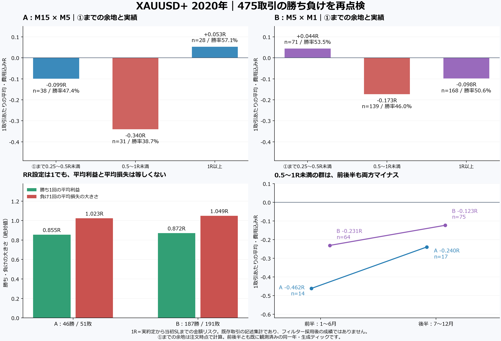

# 2020年・475取引：負けを減らすためのパターン点検

**2020年のログは残っており、全475取引を再分析した。今回の共通する弱い群は「注文価格から①終点までが、SL幅の0.5〜1倍未満」の取引。ただし、それ以外の取引も合計では負で、この区分を外すだけで黒字になるという結果ではない。**

以前の「SLが広く、①付近で入るから負ける」という見方を分解した。SLの広さだけ、①への近さだけ、抵抗の有無だけでは両時間足に共通する説明にならない。現在の年間結果では、勝ち負けの数に加え、平均利益が平均損失より小さいことが効いている。EA・RR・売買条件の変更、新しいバックテスト、パラメータ探索は行っていない。



## 元になった1年分

XAUUSD+、2020.01.01〜2021.01.01（終了排他）、v1.70、初期5,000 USD、RR1、各注文のリスク1%、①延長・逆①利益決済ON。A/Bは独立した口座計算で、合算ポートフォリオではない。v1.71の一括テスト14取引とは混ぜていない。

|項目|A：M15×M5|B：M5×M1|
|---|---:|---:|
|完了取引|97|378|
|勝ち／負け|46／51|187／191|
|費用込み勝率|47.4%|49.5%|
|純損益|−581.12 USD|−1,577.51 USD|
|ポジション純損益PF|0.749|0.801|
|平均R|−0.132|−0.099|
|平均勝ち／平均負け|+0.855R／−1.023R|+0.872R／−1.049R|
|最大連勝／最大連敗|4／6|12／8|

1Rは、実約定から最初のSLまでの金額リスク。純損益には手数料とスワップを含める。MT5帳票PFは符号別約定の集計なので、Bでは0.81と表示されるが、上表は同一ポジションへ費用を合算した定義。全475件の現金損益・初期リスク・Rを再照合した。[既存年間分析](../analysis/README.md)、[元のネイティブ整合性確認](../analysis/native_integrity.md)、[今回の独立再照合](robustness/validation.json)。

## ①までの「残り距離」と、負けの違い

LONGは注文価格から①高値、SHORTは注文価格から①安値までの距離を、SLまでの価格距離で割る。例えばSLまで100ポイント、①まで75ポイントなら0.75R。実際の約定後に価格を見て分類し直さず、ORDER時点の記録で固定した。

|①終点までの余地|A 件数／勝率／平均R|B 件数／勝率／平均R|
|---|---:|---:|
|0.25R以上〜0.5R未満|38／47.4%／−0.099|71／53.5%／+0.044|
|**0.5R以上〜1R未満**|**31／38.7%／−0.340**|**139／46.0%／−0.173**|
|1R以上|28／57.1%／+0.053|168／50.6%／−0.098|

RR1なので、①まで1RあればTPはおおむね①以内。①まで0.5〜1RならTPには①を越える値動きが必要になる。この中間群が両時間足で弱く出た。一方、①にもっと近い0.25〜0.5R群のBは平均が正で、「①に近いほど悪い」という単調な関係ではない。

|0.5〜1R群の期間|A 件数／平均R|B 件数／平均R|
|---|---:|---:|
|前半1〜6月|14／−0.462|64／−0.231|
|後半7〜12月|17／−0.240|75／−0.123|

前後半でもこの群は両組とも負。調査候補として残す。ただし、①に近い位置が原因だと証明したものではなく、相場・方向・転換方式・SL幅との構成差は残る。Aの1R以上の正の平均も前半−0.346R／後半+0.186Rと不安定なので、その群だけを選ぶ採用根拠にはしない。

0.5〜1R群以外の**既存実績**を合計しても、A66件で−2.277R、B239件で−13.259R。除外だけで期待値の問題が消えたわけではない。これは既存取引の集合の説明であり、フィルターを実装した新EAの成績ではない。発注を見送ると監視状態・後続候補も変わるため、単純な差引は新しい約定列を再現しない。

この群は手数料・スワップを分けても、約定価格間の損益成分がA平均−0.324R／B−0.140R。前後半も両組とも負で、明示的な費用だけが不振の原因ではなかった。価格成分にはスプレッド・滑りが含まれ、費用ゼロの新戦略成績ではない。[全475件の費用分解](mechanisms/cost_decomposition/README.md)。

全数と分割表は [resistance/groups.csv](resistance/groups.csv)、各取引の注文時特徴は [resistance/trades.csv](resistance/trades.csv)、[独立レビュー](resistance/review.md)。RR1では「TPが①以内」と「①余地1R以上」は実質同じ分類なので、独立した二つの根拠には数えない。丸めの境界でBは1件だけ分類が異なる。

## 広いSLが原因なのか

**今回の全数では、SLが広いほど負ける傾向は安定しなかった。** 直近値動きの大きさに対してSLが広い群（SL／上位TR14平均が2以上）は、A33件が平均+0.022R、B82件が−0.076Rで、両組とも前後半で符号が変わる。

また、SLの価格幅が広くても、リスク率によるロット計算があるため、金額損失まで同じ倍率で増えるわけではない。TPが価格的に遠くなることと、金額リスクが増えることを分ける必要がある。SLを②の外側から狭めて勝ちに見せる変更はしていない。[SL・出口の全表](mechanisms/README.md)。

## ①外側の抵抗と、ダブルトップに近い形

ユーザーの考えに合わせ、現在の密集した「最近接の全過去高安」と別に計測した。注文時点までに確定した**M15/H1の高値（LONG）・安値（SHORT）**で、元足全体が現在の①始点以前に閉じたものだけを外部候補にする。①そのものを抵抗へ数えない。確定後、既知の上位足終値で突破した水準はこの診断では消費済みとして外した。

|注文時の観測区分|A 件数／平均R|B 件数／平均R|
|---|---:|---:|
|①外側の既知水準をTPが越える|32／−0.133|54／−0.010|
|観測水準によるTP遮りなし|65／−0.132|324／−0.114|
|①と別の既知水準が±0.1R以内で重なる|22／−0.048|44／−0.231|
|その近接重なりを観測せず|75／−0.157|334／−0.081|

「TPの手前に①外側の抵抗がある」だけでは、今回の負けを共通に説明できなかった。①と外部水準の重なりはBで弱く、前半・後半も負だが、Aでは近接群の方が相対的によい。これも両組へ一律に見送りを入れる段階ではない。

±0.1Rは今回先に固定した便宜上の近接定義で、動画から決まる値ではない。水準の消費判定はAがM15終値、BがM5終値で、H1/M15の水準が人にとって重要かどうかまでは識別していない。起動後に順次蓄積したpivotだけを使うため、「観測せず」は市場に抵抗が存在しないという意味ではない。950の水準判定・54群集計を別実装でも一致確認した。[定義](resistance/definitions.json)、[全照合](resistance/review.json)。

初回は元足の開始時刻だけが①より前であれば対象にしていたが、そのH1/M15足が①起点を跨ぐと同じ波を外部と数える余地がある。最終版では足全体が①以前に閉じた条件へ修正し、Bの1件を外した。旧定義・全結果は [初期結果](resistance_initial_barstart/summary.json) に保存。①余地の群・SL・出口の集計は変わらない。

## 勝率に比べて、利益が残らない理由

RR設定は1でも、実現損益は1勝+1R／1敗−1Rにはならない。平均勝ちはA約0.86R、B約0.87Rで、平均負けは約1.02R／1.05Rだった。

|実際の出口|A 件数／合計R|B 件数／合計R|
|---|---:|---:|
|SL|51／−52.155|190／−199.277|
|TP|40／+38.602|165／+158.694|
|逆①後のプラス決済|6／+0.729|23／+3.261|

逆①後の利益決済は、1件平均でA+0.121R／B+0.142R。これも勝ち1件に数えるため、連勝していても約1RのTP連勝ほど残高は増えない。一方、逆①で閉じなければSLになった可能性もあるので、解除すれば改善するという意味ではない。設定は維持した。

現在観測した平均利益・平均損失のままなら、損益分岐の勝率は約54.5〜54.6%。実際は47.4%／49.5%だった。RRを一律に下げる案は、勝率の変化も含めた別の約定検証が必要。小さなTPにすれば勝率がそのまま維持されるという仮定は置かない。

BにはTPでもスワップ等を合算すると純損失となった1件がある。勝敗はTP/SLの名称ではなく純損益で分類した。出口と保有時間は事後の説明用であり、エントリー前に知る特徴へ混ぜない。[出口の全分解と10事例](mechanisms/README.md)。

### チャートの形と費用を分ける実例

①余地0.5〜1Rの負けから、7/1にエントリーが最も近いA/B各1件を固定して描いた。[2事例の図と選定記録](mechanisms/charts/middle_room_losses/README.md)。元のMT5画像ではなく、原本足・注文時記録からの事後レビュー図で、①の足位置とEAが知った時刻を分け、抵抗の出所も右側へ記した。[勝ち負け4事例の比較](mechanisms/charts/README.md)も保存している。

Bの7/1 23:20買いは、①まで0.67R。外側抵抗1784.12はTP1773.70より十分上で、TPをその抵抗に阻まれた例ではない。結果はSLで、価格損失−44.80 USD、手数料−1.20 USD、スワップ−46.52 USD、合計−92.52 USD（−2.246R）。約−1.09Rの価格損失へ、約−1.13Rのスワップが加わった。入口だけで損失の大きさを説明してはいけない。

年間でスワップ計上はA10件／B11件。手数料とスワップの会計整合性は確認したが、適用条件が2020年当時のものだったかは未照合。したがって、この特定時刻を避けるルールや現在のブローカー費用への一般化は行わない。[実約定・費用の全分解](mechanisms/cost_decomposition/README.md)。

## 連勝・連敗、転換方式、値幅の拡大

最大連勝はA4・B12、最大連敗はA6・B8。ただし以前の順序入替検査では、多重観察を考慮すると予測可能な集中を確定できていない。「2敗後は停止」もA/Bで揃わない。[全区間](../analysis/episodes.csv)。

年間では値幅拡大群とSIMPLE転換群が両組で弱いが、前後半・四半期へ分けると差が逆転する。月ごとのまとまりを残す20,000回の再標本化で、4つの比較を補正した区間は全て0を含んだ。これだけで恒久的な除外条件にはしない。[期間別・不確実性の全確認](robustness/README.md)。

## 次の固定確認を一つ選ぶなら

今回の追加調査では、**①余地0.5〜1R群の弱さ**を一つの検証仮説として残す。別の未使用年で区分とRR1を固定して確認し、方向や転換方式の構成差も点検する。今の2020年の前後半は既に見たデータなので、未使用期間の代用にしない。

再現しなければ、この区分を調整して救済しない。再現しても残す取引全体の費用込み期待値・件数が不足するなら採用しない。実装比較に進む場合だけ、固定した条件を一つ変えてネイティブMT5で後続候補・約定列まで確認する。今回は分析で停止し、①接続フィルター・逆①決済の解除・RR変更を行っていない。

## 原本と再現性

- [集計前に固定した計画](../../../../../knowledge/experiments/2026-10-23-wave33-pattern-review-plan.md)
- [年間の原本バッチ](../20261022_161002_0ef87d9b/review.md)
- [今回の会計・時刻・ハッシュ監査](robustness/validation.json)
- [原本・現在のEA不変と全成果物の確認](validation.json)
- [抵抗分析の全475件・既知時刻](resistance/trades.csv)
- [機構別の固定区分・事例](mechanisms/README.md)

```powershell
python tools/wave33_visual/annual_resistance_patterns.py
python tools/wave33_visual/annual_loss_mechanisms.py
python tools/wave33_visual/annual_pattern_robustness.py
python tools/wave33_visual/annual_cost_decomposition.py
python tools/wave33_visual/render_annual_pattern_summary.py
python tools/wave33_visual/render_annual_pattern_cases.py
python tools/wave33_visual/render_annual_pattern_cases.py --selection middle_room_losses
```

原本は全期間が生成ティック。2020年当時のスワップ条件、実ティック執行、休場と欠損の独立検証は未確認。別年・別銘柄での収益性を示す結果ではない。A/Bは同じ相場を使うので、独立した二つの再現標本とも扱わない。
