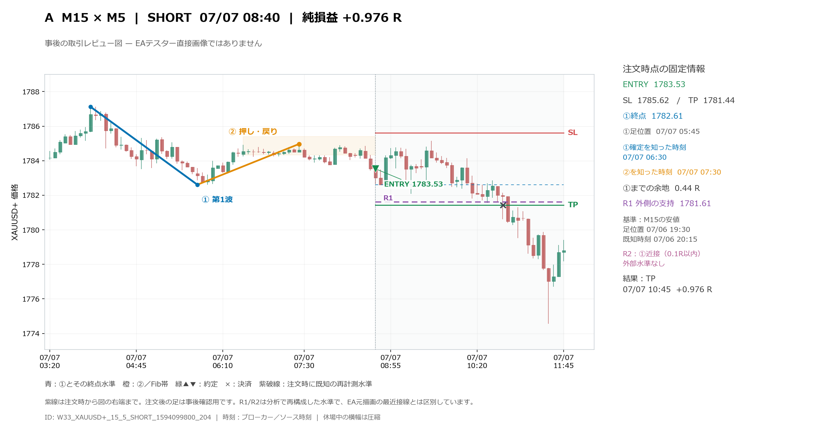
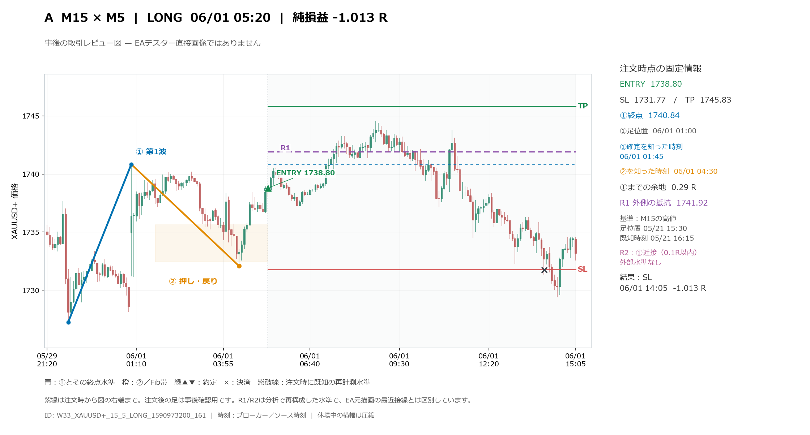
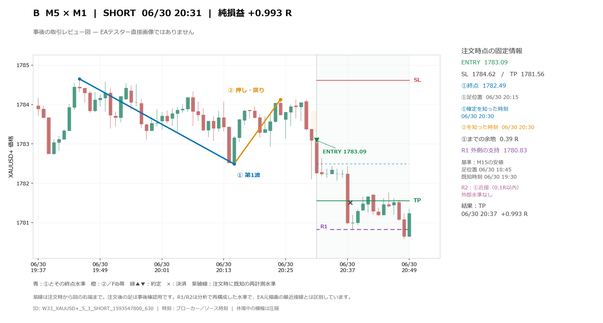
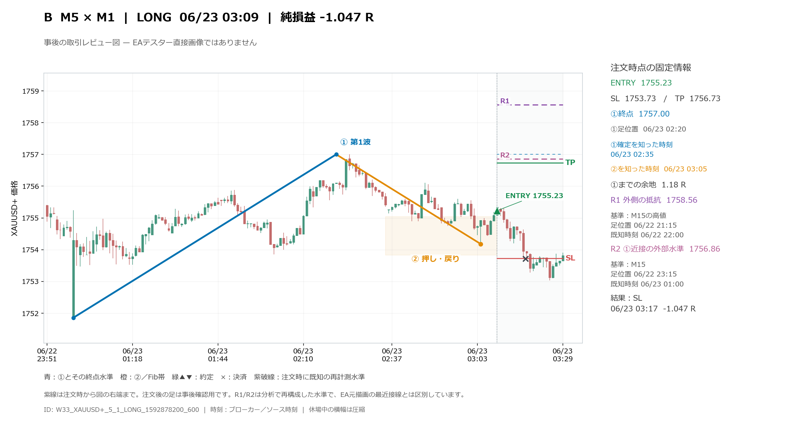

# 注文時の波と既知水準：4事例

これは原本lower_bars.csvと注文時スナップショットから描いた事後の取引レビュー図です。MT5のテスター直接画像ではありません。①の足位置と、EAが確定を知った時刻は別に記載しています。

resistance/cases.csvの中から、A/B×純損益WIN/LOSSについてエントリー時刻が最初の各1件を固定選択しました。損益の大小による選抜はしていません。したがって全475件からの無作為標本でも、代表性を保証する標本でもありません。

紫のR1は①の外側にある未消費の既知M15/H1高値／安値、R2は①から0.1R以内にある別の既知水準です。出所の足時刻・時間足・既知時刻は右側に記載し、線は注文時から右へ有限に描きます。R1/R2は今回の分析で再構成した水準で、元EAが拾った最近接線そのものではありません。注文後の足は取引結果を確認する背景にだけ使い、入口の特徴計算には混ぜていません。

## A WIN：W33_XAUUSD+_15_5_SHORT_1594099800_204

## A LOSS：W33_XAUUSD+_15_5_LONG_1590973200_161

## B WIN：W33_XAUUSD+_5_1_SHORT_1593547800_630

## B LOSS：W33_XAUUSD+_5_1_LONG_1592878200_600

再現：`python tools/wave33_visual/render_annual_pattern_cases.py`。選択規則、入力ハッシュ、IDはselection_manifest.json。
