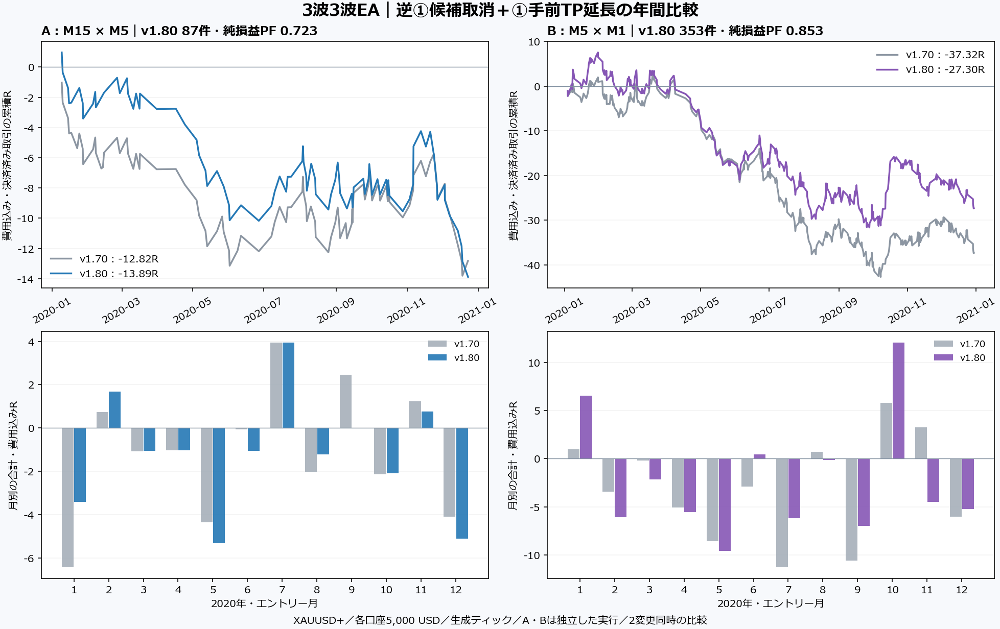

# v1.80・2020年：Bは損失縮小、Aは悪化

**年間バックテストはA/Bとも完了した。接続逆①候補の取消とTP延長は指定どおり動作したが、A/Bとも年間損益は負。Aは旧版より49.53 USD悪化し、Bは323.16 USD改善した。最大連敗はA6・B8で変わらない。**

ユーザーの完了連絡を受けて原本を確認し、前回v1.70と比較した。EA・設定を変更せず、追加バックテストや最適化も行っていない。2変更を同時に入れた比較なので、取消とTP延長それぞれの因果効果を完全に分離した実験ではない。

## 年間結果

XAUUSD+、2020.01.01〜2021.01.01（終了排他）、初期5,000 USD、各注文risk1%、基本RR1。v1.80は新2機能ON・TP余裕10ポイント、①延長・上位終値61.8%除外・逆①利益決済は旧版と同じ。A/Bは独立した口座計算。

| 指標 | A旧v1.70 | A新v1.80 | B旧v1.70 | B新v1.80 |
|---|---:|---:|---:|---:|
| 完了取引 | 97 | 87 | 378 | 353 |
| 勝ち／負け | 46 / 51 | 38 / 49 | 187 / 191 | 156 / 197 |
| 費用込み勝率 | 47.4% | 43.7% | 49.5% | 44.2% |
| ポジション純損益PF | 0.749 | 0.723 | 0.801 | 0.853 |
| 純損益 USD | −581.12 | −630.65 | −1,577.51 | −1,254.35 |
| 合計R | −12.82 | −13.89 | −37.32 | −27.30 |
| 1取引平均R | −0.132 | −0.160 | −0.099 | −0.077 |
| 平均勝ち／平均負け | +0.855 / −1.023R | +0.967 / −1.033R | +0.872 / −1.049R | +1.135 / −1.037R |
| MT5最大有効証拠金DD | 12.85% | 13.70% | 36.27% | 33.29% |
| 最大連勝／連敗 | 4 / 6 | 4 / 6 | 12 / 8 | 11 / 8 |

純損益PFは同一ポジションへ手数料・スワップを合算した定義。MT5帳票の符号別約定PFは新版A0.73/B0.86で、丸めと集計定義が異なる。Rの分母は実約定から初期SLまでの金額リスク。DDはMT5の有効証拠金DDで、独立再計算した決済残高DDとは区別した。



前回より勝率は低下したが、勝った場合の平均利益は両組で増えた。Bは平均利益の増加が全体の相対改善につながった一方、実際の44.2%の勝率は、今回の平均勝ち・負けから求めた損益分岐約47.8%に届かない。Aの同じ計算は約51.7%で、実際43.7%。これは観測値の説明であり、RRを変えても勝率が維持されるという予測ではない。

## 接続逆①候補の取消

| 項目 | A | B |
|---|---:|---:|
| 接続逆①で無効化した候補 | 27 | 76 |
| うちLONG / SHORT | 20 / 7 | 40 / 36 |
| 旧版で実際に約定していた同一候補 | 11 | 31 |
| その旧取引の勝ち／負け | 7 / 4 | 23 / 8 |
| その旧取引の合計R | +0.928 | +2.174 |
| 同一条件・日時で比較できる共通取引 | 86 | 346 |
| 旧版だけの取引 | 11 | 32 |
| 新版だけの取引 | 1 | 7 |

取消全103候補に、その候補からのORDER/FILLが存在しないことを確認。原因逆①の候補発生イベントが先にあり、確定済みの共有終点の日時・価格が一致し、情報は判断時点で既知だった。取消数には、旧版でも結局発注しなかった候補を含む。したがって「取消103件＝103敗を防いだ」とは解釈しない。

取消に対応する旧取引には勝ちも多く、旧観測取引を合計するとA/Bとも正だった。この対応表は旧版で実際に起きた結果の参照であり、新版の取消候補に仮想損益を付けたものではない。Bの旧版だけの32取引のうち、残る1件は7/1 23:20 LONG（旧−2.246R）で、新版の同方向候補監視中による見送りだった。取消と長い保有の両方が、別の候補の採用にも影響する。

共通取引はIDだけで結合せず、方向・①起点の日時と価格・上位ブレイク足・実約定日時で照合した。全共通取引の約定価格とSLが一致した。取消と保有時間の変更で後続取引も入れ替わるため、旧成績から取り消した取引だけを差し引く方法では新版を再現できない。[全候補・共通/新規/除外取引](features/README.md)。

## TP延長の利点と欠点

TP延長はA22件、B131件の実約定で採用された。TPを延長した群全体の実現成績はA−1.50R、B−11.59Rで、この群だけでもプラスではない。延長しなかった群と相場・入口の構成が異なるため、単純に群を選ぶ採用判断には使わない。

同じ約定価格・SLで比較できる共通取引のうち、実際にTPが変わった群は次のとおり。

| 共通エントリーのTP変更群 | A | B |
|---|---:|---:|
| 件数 | 22 | 129 |
| 旧版の合計R | −0.395 | −19.992 |
| 新版の合計R | −1.501 | −9.985 |
| 差 | −1.106 | +10.006 |
| 旧版は勝ち→新版は負け | 2件 | 11件 |

**TP延長は、利益幅を増やす代わりに旧TPで取れていた勝ちを逃す場合がある。** Bは同じ入口の群で相対改善し、Aは悪化した。全変更を同時に反映した実行同士の観測比較であり、費用、逆①決済、後続の保有制限、残高によるロットの影響まで独立に固定した反実仮想ではない。

同じ入口・SL・①終点を持つ共通取引から、Rの改善が最大の例と悪化が最大の例を事後に1件ずつ選んだ。典型例・全体の頻度とは区別する。

| Bの実例（ブローカー時刻） | 旧TP → 新TP | 費用込みRの変化 |
|---|---|---:|
| 10/12 13:32 SHORT | 1921.79 → 1919.16 | +0.943 → +3.434R |
| 08/21 21:21 LONG | 1941.22 → 1942.00 | +0.978 → −1.312R |

後者は、旧版が8/21 23:55にTP、新版が8/24 01:05にSLとなり、保有も週末を跨ぐ長さに変わった。新旧で同じ銘柄・約定値・SLでも、価格損益と保有費用を一緒に確認する必要がある。明細は[examples.csv](features/examples.csv)。現金額は残高によるロット変化も含むため、同一入口の比較ではRを併記する。

## 連勝・連敗と弱い群

Bの最大連勝は10/8 06:06〜10/19 21:48の11勝、+15.35R。旧版の12勝・+9.78Rより勝ち数は少なく、利益幅は大きい。最大連敗8は4/7〜4/27と7/31〜8/7の2区間。Aは最大4連勝・6連敗のまま。[全連続区間](episodes.csv)。

固定勝敗数の順序入替9,999回では、Bの11連勝は片側p=0.019だったが、A/Bの連勝・連敗・区間数の6比較を補正するとp=0.114。今回も、連勝・連敗を事前に判別する根拠が確定したとは扱わない。前回と同じ2020年を再び見た結果であり、未使用年の追試ではない。

注文時点で観測できる群の記述集計では、①まで0.5〜1Rの群はA28件で平均−0.235R、B131件で−0.182R。値幅拡大群もA−0.301R/B−0.226Rで負だった。一方、転換方式はAのNORMALIZEDが−0.288R、Bは+0.025Rと揃わない。BのSHORT群は+0.043R、LONG群は−0.201Rだが、同じ1年内の方向差をそのまま採用条件にはしない。[全群](groups.csv)。条件や境界は調整していない。

## 価格損益と費用の差

| 現金損益の内訳 USD | A旧 | A新 | B旧 | B新 |
|---|---:|---:|---:|---:|
| 約定価格間の損益 | −466.63 | −521.80 | −993.45 | −854.07 |
| 手数料 | −72.48 | −66.06 | −448.74 | −446.34 |
| スワップ | −42.01 | −42.79 | −135.32 | +46.06 |

Bの純損益改善323.16 USDは、価格損益差+139.38、手数料差+2.40、スワップ差+181.38に分かれる。取引の入替・保有時間・方向・ロットが変わり、費用の差も大きい。改善をそのままTP幅だけの優位性とは断定しない。過去の2020年当時のスワップ仕様は未照合。価格成分にもスプレッド・滑りを含む。

## 原本の充足と判断範囲

[独立整合性監査](integrity/README.md)は**13,827 checks / 0 failures**。新440取引と旧475取引の損益・リスク・Rを照合し、新版に未決済・EXIT欠落・期間末強制決済はない。全12か月を確認し、旧新の上位/下位足CSVはバイト単位で一致した。ソースと10ヘッダーは検証済みv1.80と一致する。

全40,971,991ティックは生成ティックで、実ティックは0%。実ティック執行・2020年当時の費用・休場と欠損の外部照合は未実施。前回から既に観測した同一年の記述比較であり、OOSの優位性確認ではない。通常口座への注文・追加実験・EA修正には進んでいない。

この段階では「指定した形へ近づいたこと」と「利益が出ること」を分けて評価する。Bの相対改善をAへ一般化せず、TPを伸ばした勝ちと取り逃した勝ちの両方を目視対象に残す。次の検証を設計する場合は2変更を分けて固定比較するのが適切だが、今回は分析結果の保存で終える。

原本：[COMPLETED batch](../20261023_164915_831ff154/review.md)。[特徴・全比較](features/summary.json)、[ネイティブ明細](integrity/native_positions.csv)、[取引一覧](trades.csv)、[連続統計・定義・ソースハッシュ](streak_summary.json)。

```powershell
python tools/wave33_visual/analyze_annual_streaks.py --batch reports/backtest/runs/wave33_v180_2020/20261023_164915_831ff154 --out reports/backtest/runs/wave33_v180_2020/analysis --a-run v180_a_both --b-run v180_b_both --ea-version 1.80
python reports/backtest/runs/wave33_v180_2020/analysis/render_comparison.py
```
