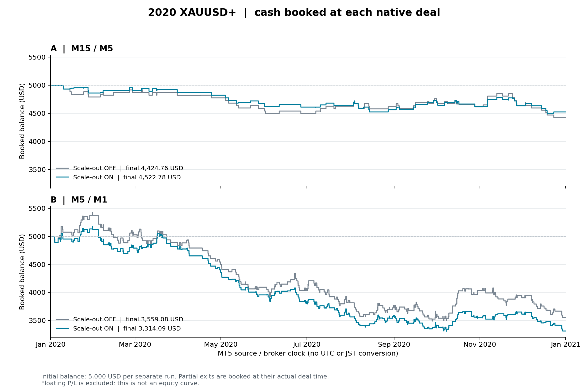

# Wave33 v1.85: 半分利確・建値SLの年間結果

**完了。固定年間4条件、独立照合23,112項目PASS。** [全結果](20261026_100045_50909ab6/analysis/summary.json) / [別方式の全4条件再集計](20261026_100045_50909ab6/root_final_totals.json) / [完了記録](20261026_100045_50909ab6/status.json)。

XAUUSD+、2020.01.01〜2021.01.01、各条件を初期5,000 USD・risk 1%・RR入力1.0で独立実行した。A=M15×M5、B=M5×M1。各組の入力差は `InpScaleOut` と保存用タグのみ。期間・閾値・銘柄を途中変更せず、現行版OFFを取り直して比較した。

| 時間足 | 分割 | 元position数 | 純損益 USD | position PF | 合計R | 最大連敗 | 証拠金最大DD |
|---|---|---:|---:|---:|---:|---:|---:|
| M15×M5 | OFF | 82 | -575.24 | 0.730 | -12.904 | 6 | 11.77% |
| M15×M5 | ON | 82 | -477.22 | 0.700 | -9.993 | 4 | 10.54% |
| M5×M1 | OFF | 334 | -1,440.92 | 0.822 | -32.553 | 8 | 35.90% |
| M5×M1 | ON | 335 | -1,685.91 | 0.733 | -41.416 | 7 | 36.44% |

損益・PF・R・連敗は入口から全決済までを元position IDで合算し、profit/commission/swap/feeを含む。MT5帳票の部分決済ごとの取引数やPFとは区別する。raw全deal純損益とMT5総損益は全4条件とも差0.00。重複deal・未決済・テスト終了強制決済は0。全12か月の確定足、各組の足CSV hash、全条件の40,971,991ティック、runtime・凍結物hashを照合した。

図は各dealの実時刻に損益・全費用を反映した残高で、浮動損益を含むequity曲線ではない。時刻はMT5のsource/broker時計を保持し、UTC/JST変換を仮定しない。[図の現金フローとhash](20261026_100045_50909ab6/analysis/balance_plot_manifest.json)。

## 新しい出口の実動作

| 分割ONの実約定positionを対象 | M15×M5 | M5×M1 |
|---|---:|---:|
| 実約定したposition | 82 | 335 |
| 半分数量の決済確認 | 43 | 173 |
| その後の建値SL確認 | 43 | 173 |
| 基本RR目標で先に半分利確 | 9 | 51 |
| ①手前で先に半分利確 | 34 | 122 |
| 建値変更を距離制約で保留、その後成功 | 0 | 4 |
| 建値SL変更の拒否 | 0 | 0 |
| 部分決済が注文時間外で拒否されたposition | 1 | 1 |
| 半分の前にbroker最終TPで全量決済 | 1 | 3 |
| 最小数量の分割不可fallback | 0 | 0 |

注文時間外の10018はAで46回/Bで58回のイベントだが、各1positionの再試行である。Bはその後に半分約定と建値変更、Aは最終TPの全量約定へ進んだ。途中の半分約定を補完しない。Bの建値保留4positionは全て後に成功した。[例外の実時刻と理由](20261026_100045_50909ab6/analysis/execution_exceptions.json)。最小ロットfallbackは年間では観測0で、別の実注文QAで確認済み。

[各組5件の機能確認用事例](20261026_100045_50909ab6/analysis/review_cases.md) / [全position](20261026_100045_50909ab6/analysis/positions.csv) / [同一①の比較](20261026_100045_50909ab6/analysis/paired_positions.csv)。事例は各方向・目標順序の最初の該当例と最終TP先行例を抽出する。利益の良い例を選ぶための抽出ではなく、動画や各市場波形の目視一致を保証するものでもない。

## 解釈

M15×M5は損失が98.02 USD縮小し、最大連敗も6→4へ減った。M5×M1は損失が244.99 USD増え、合計RとPFも低下した。勝ち数はA36→47、B144→181へ増えたが、**両パターンとも黒字化しておらず、出口変更だけで期待値改善を確認したとは言えない**。

出口により保有時間・後続候補の採否・複利ロットが変わる。BにはONだけの1positionがあり、同じ約定集合への単純なTP差ではない。固定比較後に追加フィルターやRRの救済最適化を行っていない。

## 精度と再現

Model4を要求したが2020年リアルティックのキャッシュがなく、全条件とも **0%リアルティック・生成全ティック**。各runの `report.htm` と `journals/` に原本を保存した。既知期間の機能・回帰・記述的比較で、OOS、実ティックの執行品質、demo/liveへの昇格試験ではない。ネイティブ口座方式はRETAIL_HEDGINGで、netting実注文は未検証。

[事前計画](PLAN.md)、[実行物と実設定](20261026_100045_50909ab6/provenance.json)、[凍結集計コード](20261026_100045_50909ab6/method/)、[最終短期smoke642項目](smoke/20261026_095845_982f2480/analysis/README.md)、[機能・表示QA](../../../qa/w33_scaleout_20261026/README.md)。既存端末を止めず専用portableで順次実行した。

ユーザーのビジュアル確認には [A分割ON](../../../../presets/wave33/Wave33ScaleOut_v185_A_On.set) / [B分割ON](../../../../presets/wave33/Wave33ScaleOut_v185_B_On.set) を読み込み、テスターの新しい実行を開始する。EAは `Wave33ChopDiagnostic` v1.85。`InpScaleOut=false` で従来の一括TP延長へ戻せる。半分は数量stepで切り捨て、2分割できなければロットを増やさず近いTPで全量決済。建値SLは価格上の建値で、費用込み損益ゼロの保証ではない。
