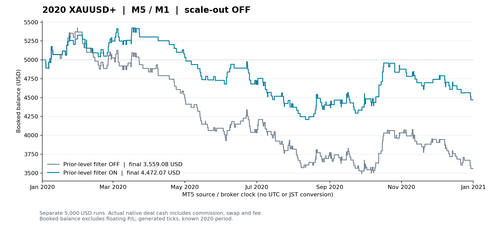

# M5×M1 上位高安帯の見送り比較・2020年

**損失額とDDは縮小したが、費用込み期待値はまだ負。採用しない。** EA・帯幅・RRを修正せず、既存の `InpSkipPriorLevelRetest` だけをOFF→ONとして、同一2020年をMT5で新たに2回実行した。部分利確は両方OFF。

## 固定した条件と根拠

XAUUSD+、M5×M1、2020.01.01〜2021.01.01、初期5,000 USD、risk1%、RR入力1.0。帯片幅は第1波値幅の5%で固定。元のSL・TP延長・逆①後の利益決済・深いFib終値除外・接続①取消も固定した。

この見送りは、**第1波が始まる前の既知M15/H1高値・安値帯に①終点が重なり、未突破の帯より先に最終TPがある**という既存条件。LONGは過去高値帯、SHORTは過去安値帯を使う。完成後のダブルトップ・ダブルボトムを見て過去の入口を選び直したものではない。[凍結計画](PLAN.md)／[元の提案](../../../../knowledge/experiments/2026-10-26-wave33-next-entry-diagnostic.md)。

## 全年の結果

| 指標 | 見送りOFF | 見送りON |
|---|---:|---:|
| 完了position | 334 | 215 |
| 費用込み損益 | −1,440.92 USD | −527.93 USD |
| position単位・費用込みPF | 0.8223 | 0.9112 |
| 合計R | −32.5529R | −10.1467R |
| 平均R | −0.09746R | −0.04719R |
| 勝ち／負け | 144／190 | 93／122 |
| 勝率 | 43.11% | 43.26% |
| 最大連敗 | 8 | 8 |
| native最大equity DD | 1,949.10 USD（35.90%） | 1,276.90 USD（23.41%） |
| 最終残高 | 3,559.08 USD | 4,472.07 USD |

損益差は **＋912.99 USD／＋22.4062R**。損失額は約63%小さくなった。ただし取引数も減っており、勝率はほぼ変わらず、最大連敗も8のまま。今回の改善だけでは、負けが続く問題や残った入口の負の期待値を解決していない。

図は全native dealのprofit＋commission＋swap＋feeを実発生時点で残高へ加えたもの。含み損益を含むequity curveではない。時計はMT5原本のsource/broker時刻で、UTC/JSTへの変換はしていない。[図の原本・検算](20261026_164002_b8936809/analysis/balance_plot_manifest.json)。

## 何を除外し、その後に何が変わったか

旧約定のうち実際に消えた119件は、勝ち51件・負け68件、旧ロットで合計−22.4096R。ONでも約定した215件は、全件で同じ①・同じ入口時刻・同じ入口価格・同じSL/TPだった。ONだけの追加約定、同じ①の入口時刻変更はいずれも0件だった。[全照合](20261026_164002_b8936809/analysis/paired_positions.csv)。

一方、全SIGNALは482→483件、ONの `PRIOR_LEVEL_RETEST` 見送りは210件。**210件の見送りと、旧約定から消えた119件は異なる母数**である。既に別条件で未発注だった候補や、新しく観測できた候補も含まれる。[全SIGNAL時点の根拠](20261026_164002_b8936809/analysis/signal_context.csv)。

334−119＝215という件数は今回たまたま新MT5結果とも一致したが、単純な過去取引削除をEA結果の代わりにしていない。旧215件の単純残存集計は−476.75 USD、実ONは−527.93 USDで、51.18 USD違う。共通215件のうち189件で複利後のロットが変わっている。

さらに共通215件中1件は、秒ログでは同じ決済時刻・理由でも、native fillに差があった。2020.12.23のLONG逆①利益決済は、OFFが1872.68／22:59:01.408、ONが1872.67／22:59:01.126（282ms差）。ロットは0.11→0.14。既存の費用込み「厳密にプラス」の決済ゲートと数量・丸めの影響が考えられる。全215件の出口価格が同じとは扱わない。残り214件は入口・出口のmillisecond時刻と価格も同じ。共通215件の合計R差は−0.003395R。[native差の詳細](20261026_164002_b8936809/analysis/common_execution_geometry.json)。凍結解析の `matched_exit_changed=0` は秒単位ログでの一致で、この補助比較と区別する。

## 偏りを含む四半期・方向別

四半期は入口時点で分類した。各群の平均Rを使い、良かった群だけを次の採用対象にはしない。

| 入口四半期 | OFF件数 | OFF損益 USD | OFF平均R | ON件数 | ON損益 USD | ON平均R |
|---|---:|---:|---:|---:|---:|---:|
| Q1 | 83 | −160.07 | −0.0247 | 60 | ＋306.79 | ＋0.1096 |
| Q2 | 64 | −764.41 | −0.2760 | 34 | −581.31 | −0.3510 |
| Q3 | 105 | −515.16 | −0.1250 | 71 | −307.10 | −0.0890 |
| Q4 | 82 | −1.28 | ＋0.0036 | 50 | ＋53.69 | ＋0.0307 |

| 方向 | OFF件数 | OFF損益 USD | OFF平均R | ON件数 | ON損益 USD | ON平均R |
|---|---:|---:|---:|---:|---:|---:|
| LONG | 165 | −1,703.04 | −0.2357 | 97 | −1,100.62 | −0.2367 |
| SHORT | 169 | ＋262.12 | ＋0.0375 | 118 | ＋572.69 | ＋0.1086 |

LONGの1件あたり損失は改善せず、Q2も平均Rが悪化した。SHORTの平均Rは改善したが、この既知年からSHORTだけを選んで採用する検証は今回行っていない。[全四半期×方向](20261026_164002_b8936809/analysis/groups.csv)。

## 整合監査と制約

- 2条件完了、凍結解析 **PASS／20,397項目・0失敗**。[原本](20261026_164002_b8936809/analysis/summary.json)
- OFFは旧334position／−1,440.92 USDを再現。旧全668dealの数量・価格・時刻・全費用等15項目、受理upper/lower barsのbytehashが一致。実observed config103項目はtag以外102項目が一致し、contract・最小ロット・tick・stops等も同一。[厳密config監査](20261026_164002_b8936809/analysis/strict_config_reproduction.json)
- 全raw dealとnative HTML、positionの全費用cash、元SL・実約定数量による初期リスク、R、残高DDを照合した。rootの別方式raw再集計もPASS。[別方式監査](20261026_164002_b8936809/analysis/root_independent_totals.json)
- 両条件は40,971,991生成ティック、355,233 M1 bars、受理足は12か月を観測。nativeは**0%リアルティック**。実ティック品質を確認した結果ではない。
- 既に見た2020年の機序診断。未使用期間の確認ではなく、2026データも使っていない。過去のcommission・swapの実勢一致や将来約定条件は別検証。
- EAソース・EX5・17headersは旧最終QAのSHA256と一致し、今回のEAロジック変更と再コンパイルはない。凍結method・実行環境は[provenance](20261026_164002_b8936809/provenance.json)に保存した。

**判定: `NO_PROMOTION_NEGATIVE_EXPECTANCY`。** 上位高安帯を避ける考えには損失を減らした証拠があるが、残存全体は負の期待値で、方向・時期にも偏る。新たな帯幅・RR探索、SHORTだけの選抜、未使用期間や実口座への昇格は行わない。既存のデフォルト設定も変更していない。
