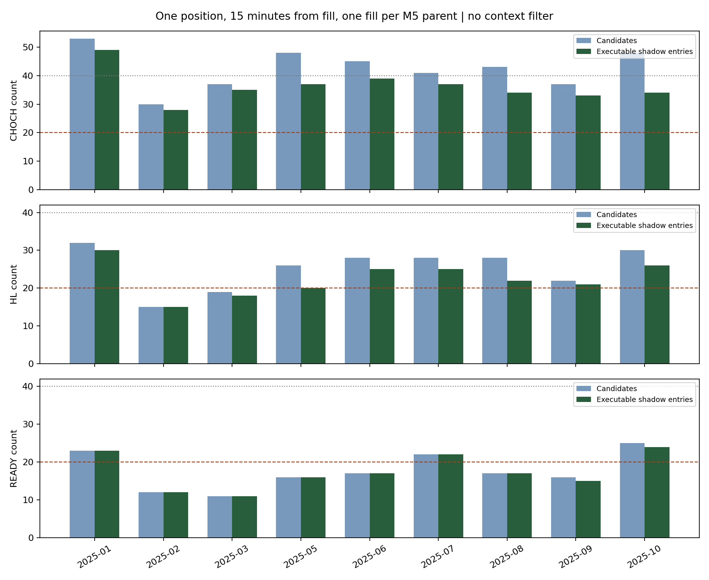
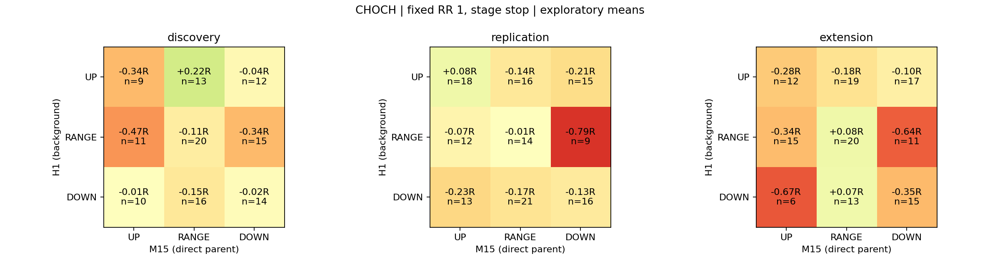

# M5の3波 × M1の3波：H1・M15環境研究

## 結論

**H1・M15の環境で成績の差は見えたが、安定した正の期待値は確認できなかった。** 今回の確定高安による定義では、CHoCHの **H1 RANGE × M15 DOWN** が3期間とも悪く、次の「回避すべき環境」仮説として最も分かりやすい。一方、H1 UP × M15 UPが一貫して良いわけではなかった。

**無条件のCHoCHなら、1ポジション・約定から15分クールタイム・同じM5親波で1回でも月28〜49回。** 最低月20回は全9か月で維持した。ただし平均Rは3期間とも負。理想の毎月40回には届かない。

環境を1区分だけ選ぶと機会が大きく減る。主SLでは、候補・無条件採用・環境単独の仮想採用のいずれにも、3期間すべてで平均Rが正の区分はなかった。**現行EAへフィルターを追加する段階ではない。** 現行EA・Shared・前回研究EAは変更していない。

## 1. 期間と対象

| 区分 | 期間 | 主分析候補 |
|---|---|---:|
| discovery | 2025年1〜3月 | 232 |
| replication | 2025年5〜7月 | 271 |
| extension | 2025年8〜10月 | 266 |

合計9か月、主分析769件（CHoCH 382、初回HL 228、READY 159）。生記録972件にはHL更新203件も含む。主分析は親波・M1転換・段階ごとの最初の候補を使用する。段階を足し合わせて独立した売買機会とは数えない。

9環境に分けると30件未満の区分があったため、[事前計画](plan.md)に従い8〜10月を一度だけ追加した。[延長判断](extension_decision.json)は件数に基づき、利益が出るまで延長したものではない。既存の1〜3月・5〜7月は過去の研究でも見ており、未使用OOSとは呼ばない。

## 2. 環境の定義と未来情報の排除

- **H1：大きな地合い。M15：M5の直接上位足。** 同じ計算法で独立して記録する。
- 左2本・右2本より厳密に高い／低い確定ピボット。同値は不採用。形成中足を除き、右2本の閉鎖時刻以降だけ使用する。既存Sharedの判定は変更せず、これは環境記述用の別定義。
- **UP：** 直近2高値と2安値が両方切り上がる。**DOWN：** 両方切り下がる。**RANGE：** 方向混在または同値。必要ピボット不足はUNKNOWN。
- RANGEは低ボラ・横ばいの保証ではない。また、確定ピボット分類なので、H1なら右2本だけでも約2時間の遅れがある。候補直前の転換を即座に表す分類ではない。
- **現在位置：** `(候補のAsk − 最新確定安値)/(最新確定高値 − 最新確定安値)`。0未満・1超を切り詰めない。高安が逆転・同値なら位置を欠損扱いにする。
- **上値余地R：** `(最新確定高値 − 候補のAsk)/その候補のSL幅`。最新高値を超えていたら負値を残す。「次の抵抗線」を未来の高値から選び直さない。
- **補助EMA傾き：** `(最後の確定EMA20 − 3本前のEMA20)/(3×確定ATR14)`。

各ピボットの価格・時刻・確定時刻、最後の確定足時刻、元のOHLCを保存した。`CopyRates`の配列は古い順で扱い、形成中足を外す。指標も確定足のバッファだけを読む。[CopyRates公式仕様](https://www.mql5.com/en/docs/series/copyrates)、[CopyBuffer公式仕様](https://www.mql5.com/en/docs/series/copybuffer)

## 3. 月別の候補数と実行可能回数

各セルは **候補 / 制約適用後**。SLはSTAGE。各段階を独立した戦略として再生した結果で、3列を合算しない。

| 月 | CHoCH | 初回HL | READY |
|---|---:|---:|---:|
| 2025-01 | 53 / 49 | 32 / 30 | 23 / 23 |
| 2025-02 | 30 / 28 | 15 / 15 | 12 / 12 |
| 2025-03 | 37 / 35 | 19 / 18 | 11 / 11 |
| 2025-05 | 48 / 37 | 26 / 20 | 16 / 16 |
| 2025-06 | 45 / 39 | 28 / 25 | 17 / 17 |
| 2025-07 | 41 / 37 | 28 / 25 | 22 / 22 |
| 2025-08 | 43 / 34 | 28 / 22 | 17 / 17 |
| 2025-09 | 37 / 33 | 22 / 21 | 16 / 15 |
| 2025-10 | 48 / 34 | 30 / 26 | 25 / 24 |



実行制約：1ポジション、直前の**約定時刻から15分**経過、同じM5親波は1回。保有が15分を超えたら決済まで待つ。拒否理由と候補IDは[execution_ledger.csv](execution_ledger.csv)へ保存。同時候補は新しい親波を優先し、損益で選ばない。月が変わっても状態を継続する。連続する7月末・8月初の区切りは、持越し・クールタイム・同じ親波の重複がないことを[確認した](boundary_audit.json)。

集計は次の3種類を区別した。

1. `CANDIDATES`：制約前の全候補。
2. `UNFILTERED_ACCEPTED`：無条件で時系列再生し、採用されたものを環境別に分類。
3. `CELL_ONLY_CAPACITY`：その環境だけを仮に対象とする独立した再生。各環境の回数を合算して1つの戦略の回数とはしない。実際のフィルター実装ではない。

[全月・全環境・両SL基準の件数](monthly_counts.csv)

## 4. H1 × M15による成績の違い

### CHoCH：全9環境

各セルは **件数 / Expectancy R**。主SL、RR1、制約前候補。

| H1 / M15 | 1〜3月 | 5〜7月 | 8〜10月 |
|---|---:|---:|---:|
| UP / UP | 9 / -0.344 | 18 / +0.081 | 12 / -0.282 |
| UP / RANGE | 13 / +0.220 | 16 / -0.141 | 19 / -0.175 |
| UP / DOWN | 12 / -0.044 | 15 / -0.208 | 17 / -0.096 |
| RANGE / UP | 11 / -0.469 | 12 / -0.070 | 15 / -0.343 |
| RANGE / RANGE | 20 / -0.114 | 14 / -0.007 | 20 / +0.080 |
| RANGE / DOWN | 15 / -0.344 | 9 / -0.787 | 11 / -0.645 |
| DOWN / UP | 10 / -0.006 | 13 / -0.233 | 6 / -0.671 |
| DOWN / RANGE | 16 / -0.147 | 21 / -0.171 | 13 / +0.071 |
| DOWN / DOWN | 14 / -0.019 | 16 / -0.132 | 15 / -0.351 |



**最も一貫した悪化方向はH1 RANGE × M15 DOWN。** 他の環境との差は順に -0.240R、-0.679R、-0.472R。ただし差の95%区間は `[-0.772, +0.325]`、`[-1.034, -0.116]`、`[-1.154, +0.162]`。3期間中2期間はゼロを含む。方向一致はあるが、小標本・多重比較を考えると確立した優位性ではない。

**H1 UP × M15 UP、H1 UP × M15 DOWNも正期待値の再現なし。** 上位足が両方上向きなら十分、あるいはH1上昇中のM15押しなら十分、とはいえない。DOWN × DOWNも3期間とも負だった。

H1単独ではUPが他状態より相対的に良かったが、CHoCH平均は -0.023R、-0.080R、-0.174R。M15単独ではRANGEが -0.036R、-0.116R、-0.015Rで他状態より良かった。**どちらも「相対的に悪くない」と「正の期待値」を区別する必要がある。**

### HL・READY

- 主SLで3期間すべて平均Rが正の環境は、HLにもREADYにもなかった。
- HLのUP / UPは -0.352R、+0.101R、+0.070Rだが、件数は3、9、7。1〜3月は負で、採用根拠には足りない。
- READYのUP / UPは +1.000R、-0.153R、+0.566Rだが、件数は1、7、5。初期の1件の勝ちを良い環境の証明にしない。
- READYのRANGE / DOWNは0、4、5件で、平均Rは未定義、-1.011R、+0.064R。CHoCHの悪い傾向を、READYまで同じ強さで一般化できない。

**全段階・全環境の件数、勝率、R、95%区間、MFE/MAE、実行回数は[比較表](regime_tables.md)に掲載。** [全統計CSV](regime_statistics.csv)、[期間ごとの安定性](regime_stability.csv)、[他環境との差の区間](regime_vs_other_intervals.csv)も保存した。

## 5. 現在位置・上値余地・補助EMA

単独区分のみを比較し、regimeとの追加AND探索は行っていない。位置は「安値未満／下半分／上半分／高値超」、余地は「0以下／0〜1R未満／1〜2R未満／2R以上」、EMA傾きは符号だけで固定した。

- **M15高値まで2R以上の余地があるCHoCH：** 35/45/44件、+0.018R / -0.079R / -0.282R。余地が広いだけで勝てる関係は再現しなかった。
- **H1高値まで2R以上：** 68/84/80件、-0.098R / -0.130R / -0.306R。上値余地の大きさは、そこまで到達する確率を保証しない。
- **M15レンジ下半分：** 36/50/45件、+0.045R / -0.166R / -0.255R。低い位置からの入口だけでは再現しなかった。
- **H1・M15 EMA上向き：** CHoCHではそれぞれ全3期間で平均Rが負。下降側に対する優劣も期間で変わった。今回は補助情報にとどめる。
- 独立した最新高値・安値が逆転するケースのH1位置は欠損として残した。欠損をRANGEや位置0.5へ置き換えていない。

[位置・余地・EMAの全単独区分](single_context_buckets.csv)、[各環境内の特徴量分布](context_distributions.csv)

## 6. 頻度目標と次の仮説

### 月20回との両立

無条件CHoCHの実行回数は月28〜49回で最低条件を満たす。しかし採用後の平均Rは1〜3月 -0.108、5〜7月 -0.138、8〜10月 -0.119で、全期間負だった。HL・READYは月20回未満の月がある。

単一のH1×M15環境を積極採用する案は頻度が不足する。細かい良条件を重ねる方向より、**一貫して悪そうな環境を少数だけ避ける仮説**のほうが、頻度との両立を調べる価値がある。ただし今回そのフィルターは実装していない。

### 次に検証する価値があるもの

1. **CHoCHのH1 RANGE × M15 DOWNを回避する仮説。** 今回の記述結果を見て得た事後仮説であり、別の未使用期間で確認する。無条件で既に採用できた取引からこの区分だけを引いた保守的な部分集合は、月41・24・33・36・34・36・30・31・33回となり、月20を維持する。ただし平均Rは -0.080 / -0.099 / -0.079で依然負。これだけで戦略を採用可能にはできない。[事後診断](next_hypothesis_diagnostic.json)
2. **M15下降構造が終わる過程を記録する仮説。** 静的なUP一致が良くなかったため、M15 DOWN→RANGE等の「候補以前に分かった変化」と候補の時間関係を、固定ルールで調べる価値がある。現時点では未検証であり、入口を早めたりM1/M5条件を緩める提案ではない。
3. **UP × UP、上値余地≥2R、EMA上向きの即時フィルター化は見送る。** 方向・SL基準・期間・件数をまたいだ根拠が足りない。複数をANDで重ねて今回の負けを説明する探索もしない。

今回の判断は「良い環境を発見して採用」ではなく、**次に否定・再確認すべき仮説を絞れた**という段階。毎月40回と正期待値の両立は未達。

## 7. 実行可能回数・損益の前提と限界

- MT5 Model4による候補時点の実Ask入口、Bidによる仮想決済。発注関数なし。RR1、SLバッファ10points。
- STAGEのSLはCHoCHでM1転換安値、HL/READYでその時点のHL。対照として全段階をM1転換安値にそろえたREVERSAL_CONTROLも保存。Rの分母・実行占有時間が変わるため、主SLと対照を混ぜない。
- 最大保有240分、固定60分のMFE/MAE。SLギャップは実際に観測したBidの不利なRを残し、TP側の有利なギャップ利益は加算しない。勝率はTP率ではなく、打切りも含む確定結果のR>0率。
- セットファイルには前回ランナー由来の未使用の売買入力名が残るが、この研究EAのRR1・SLバッファ・仮想保有期限はソース固定で、損益式も監査済み。通常EAのパラメータ変更用ではない。
- 手数料、スワップ、追加スリッページ、ブローカーのストップ距離・証拠金・実注文拒否は未モデル化。今回の「実行可能」は占有・クールタイム・親波制約を満たす**仮想回数**で、実口座の約定保証ではない。240分打切りも現行EAの損益を完全再現する主張ではない。
- 1〜3月は3月27日に実ティック不整合・欠損による生成ティック代替警告あり。5〜7月と8〜10月には同警告なし。[各期間のaudit.json](discovery/audit.json)に品質警告を保存。
- 信頼区間は親波クラスタの固定乱数1000回再標本化。同じM1転換を共有する親波はまとめる。上位足環境が数日続く依存性や多重比較を完全に解消するものではなく、有意差・因果関係・将来収益を断定しない。

## 8. 検証・ファイル

- 研究EAと追加期間ギャップ監査はコンパイル0エラー・0警告。
- 確定ピボットのUP/DOWN/RANGE、不足、未来確認足、同値のネイティブ6ケースを検査。実行順序・15分境界・長時間保有・親波重複・打切り・空区分・不正価格等のPython 8ケースを検査。
- 全対象期間で特徴量・結果の監査、および上位足OHLCからのピボット独立復元を実施。
- 元の6か月の候補・結果CSVは前回研究とバイト一致。短期と1〜3月の再実行で環境を含む4種類のCSVがすべてバイト一致。
- 本研究の3期間で、上位足の異なる確定足スナップショット987件を独立復元し一致。環境の欠損・未来のピボット参照・取得エラーなし。
- 現行EA・Shared・前回研究版の10ファイルは開始時ハッシュと一致。追加期間の週末等69か所を別途監査し、候補取りこぼし0、取得エラー0。既存6か月の133か所の監査も前回確認済み。
- 各再生の採用レコード計2,821件について、重複親波・同時保有・15分違反なし。これは複数の比較ストリームの検査件数で、独立した取引数ではない。
- 集計コードも再実行し、主要CSV・比較表・事後診断の11ファイルがバイト一致。[分析の再実行検査](analysis_reproducibility.json)

[検証結果](reproducibility.json)、[開始時ハッシュ](baseline_manifest.json)、[研究版ハッシュ](research_manifest.json)、[実行境界の検査](boundary_audit.json)、[追加期間ギャップ監査](TW_context_gap_result.csv)

新規研究EAは `mql/Experts/USDJPY_3Wave_ContextResearch.mq5/.ex5`、環境記録は `mql/Include/ThreeWaveContextResearch.mqh`。前回研究版からの生成差分は[recorder.diff](recorder.diff)。元EA・Sharedへの差分はない。

データは各期間フォルダの `TW_features.csv`、`TW_feature_outcomes.csv`、`TW_context.csv`、`TW_context_bars.csv`。結合後の[candidates_with_context.csv](candidates_with_context.csv)には将来の損益ラベルもあるため、EAの入力として使わない。

```powershell
python tools/swing_structure/build_context_research.py
# MetaEditorで研究EAとThreeWaveContextGapAuditをコンパイル
# 許可済み独立TEMP MT5に対して run-three-wave-context.ps1 を実行
python tools/swing_structure/audit_three_wave_context.py discovery replication extension
python tools/swing_structure/analyze_three_wave_context.py
python tools/swing_structure/check_context_reproducibility.py
```

独立テスターの実行には `tools/swing_structure/run-three-wave-context.ps1`、追加期間ギャップ監査には `run-three-wave-context-gap.ps1`を使用。実口座の自動売買は無効で、通常のMT5を停止しない。
