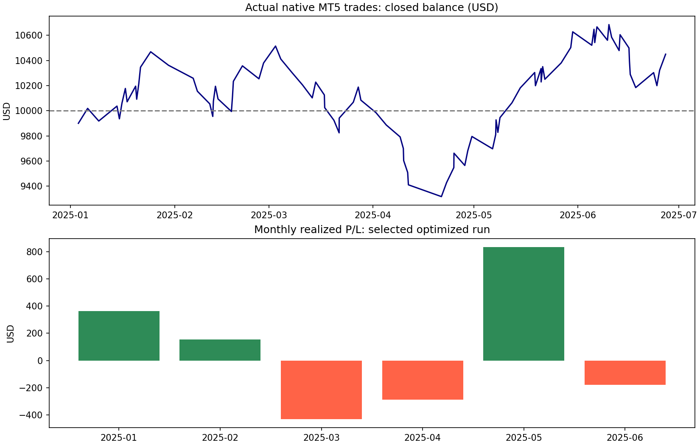
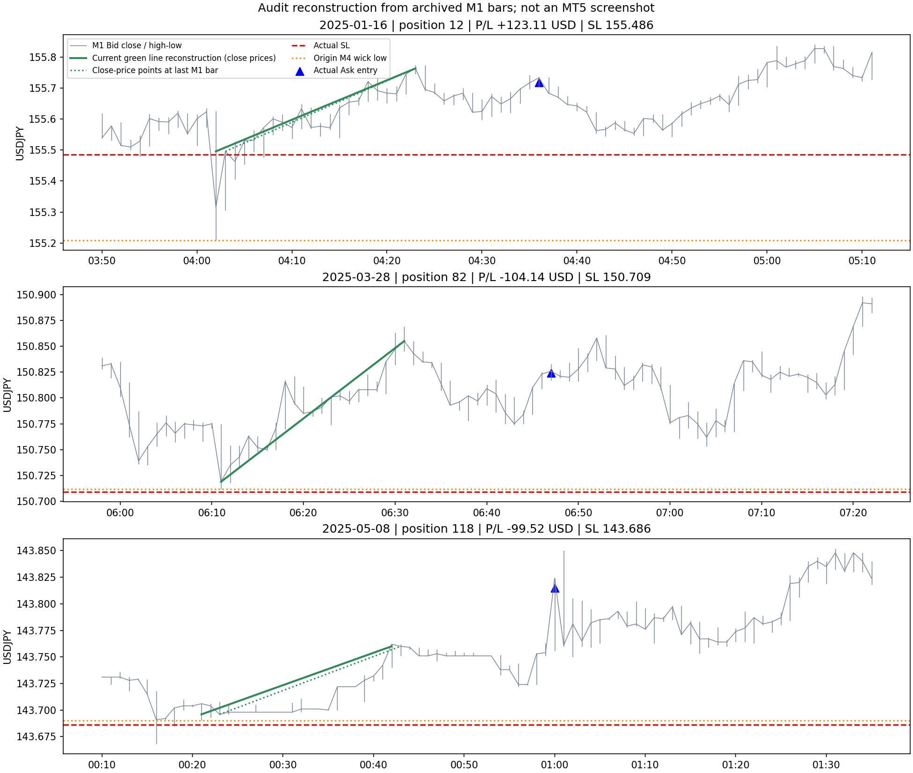

# M1/M4 ThreeWave EA review — 2026-09-26

## 結論

貼付設定と一致する既存MT5実行を確認した。2025-01-01〜2025-06-30（終了日00:00、最終取引日は06-27）の88取引で、損益は **+450.08 USD**。ただし、5月だけで+832.83 USD、5月を除くと-382.75 USDであり、安定した優位性やM4固有の優位性までは示していない。

緑線の違和感にはコード上の根拠がある。**上位足の終値を価格として使い、同じ足のヒゲ極値の時刻へ描画している。** M4そのものが無効なのではない。SLも「M4ヒゲ安値−10ポイント」ではなく「M4終値ピボット安値−10ポイント」。全88取引でこの基準と一致し、47取引ではSLが起点足のヒゲ安値より上だった。

EA/Shared/インジケーターのソースとEX5は変更していない。今回は既存実行の事後分析とコードレビュー。再コンパイル、新規バックテスト、再最適化、実売買は行っていない。

## 証拠と再現方法

- [actual_inputs.json](actual_inputs.json): 最終実行のログから抽出した入力。ユーザー貼付値と一致。
- [native_deals.csv](native_deals.csv): ローカルAgent-3001のTW_deals.csv。176約定、88往復、全てSLまたはTPで決済。
- [selected_run_evidence.log](selected_run_evidence.log): 2026-09-26 12:21:28.925開始、12:51:58.354完了の実行だけを抽出。毎分TW_M1行を除く。
- [optimization_evidence.log](optimization_evidence.log): 同日のネイティブ最適化ログ。
- [sources.json](sources.json): 原本パスとSHA256。
- [trades_review.csv](trades_review.csv): 全取引の入口、SL、TP、損益、R、起点足、参考環境。
- [monthly.csv](monthly.csv)、[streaks.csv](streaks.csv)、[descriptive_groups.csv](descriptive_groups.csv)、[h1_half_period.csv](h1_half_period.csv)。
- [分析コード](../../../../../tools/analyze_three_wave_m4_review.py): リポジトリ直下から `python tools/analyze_three_wave_m4_review.py`。

集計は既存MT5約定履歴に基づく。M4足とH1 EMAの参考分析は既存の同一ブローカーM1アーカイブ `../resistance_research/TW_resistance_M1.csv` から集約した。88件全ての最新確定M4終値安値が実発注SL+0.010と1tick以内で一致した。日時はブローカーのサーバー時刻であり日本時間に変換していない。

## 今回、実際に動いた戦略

| 入力 | 実際の効果 |
|---|---|
| HigherTF=4 | 親波はM4。M5という構造体名・チャートラベルが残っていてもM4データを使用 |
| HigherUseClosePivot=true | 親波の高値・安値はHigh/LowではなくCloseで検出、保存価格もClose |
| 上位左右1/1 | 前後1本の終値ピボット。通常、候補M4足の開始から8分で確定 |
| 下位左右1/3 | M1はヒゲ高安、右3本が閉じて確定。通常、候補足開始から4分 |
| SkipLowerHL=true / HLEntryMode=0 | M1 CHoCHの確定でREADY。M1 Wave1 High、HL、再突破は待たない |
| StopMode=2 | M4 Wave1起点の終値ピボット安値−10ポイント。M1 HL基準ではない |
| RR=1.2 | 現在Ask入口と上記SLの幅を使ってTP計算 |
| Cooldown=5 | 約定から5分。ただし保有中は別シグナルを遮断 |
| UseEMAFilter=false | 40/90/190は表示のみ。今回の利益を生んだ売買条件ではない |
| HLNearFraction=.75 | READYモードではエントリーに使われない |
| RequireFibZone=false | Fib 38.2〜61.8%の選別なし。Skip経路ではそもそもHL/Fib検査を通らない |

したがって今回の収益は、以前の「HL再接近」や完全な「M1第3波確認」を採用した成績とは区別する必要がある。

## コードレビュー：重要度順

### 1. USDJPY以外を拒否するガードがなくなっている

`mql/Experts/USDJPY_M1_M5_3WaveIn3Wave_Long.mq5:535` のOnInitには、以前の `_Symbol!="USDJPY"` 拒否がない。発注は `_Symbol` へ行われる。現在のコードはUSDJPY専用という元の制約を保証していない。今回のUSDJPY損益には影響しないが、売買用の仕様として修復優先度が高い。

また上位TF>下位TFという検証もない。同じ時間足を指定すると `BuildPivots` の `tf==InpHigherTF` 判定により下位側も終値ピボットになり得る。選択中のM1/M4では発生しない。

### 2. 終値ピボットとヒゲ時刻の描画不整合

`ThreeWaveStructure.mqh:117–141` はCloseをpivot.priceへ格納。一方、同:154以降の `AlignHigherPivotPlotTimes` は常に下位足のHigh/Low極値時刻を採用する。`ThreeWaveDrawing.mqh` の `_M5W1` 緑線はその時刻とClose価格を結ぶ。

このため「ローソク足の底・天井に線が付かない」ことがある。M4バーの切り方がM5と違う効果もあるが、主な説明は価格と時刻の意味が一致していないこと。さらに表示文言が `M5 Wave1` のままなので誤解を生む。

推奨する表示修正は、終値モードなら終値を表す時刻へ描き、`M4 / Close pivot` と表示すること。価格をヒゲへ変えてしまう修正はSLとシグナルを変えるため、表示修正とは別実験にすべき。

### 3. SLは算術エラーではなく基準の違い

EA `MakePlan` のStopMode=2は `s.origin_low.price` を参照。Closeモードではその値が足の終値である。

例：2025-01-16 04:36の取引

- M4起点足：04:00、終値155.496、ヒゲ安値155.209。
- 実際のSL：155.486（終値−0.010）。
- ヒゲ安値より0.277円＝27.7pips上にある。
- この取引自体は+123.11 USD。位置が想定と違うことと、必ず負けることは別。

88件中47件がヒゲ安値より上。47件の損益は+373.38 USD、残り41件は+76.70 USDだった。したがって「ヒゲ下に直せば利益改善」とも、この結果だけからはいえない。

起点割れの無効化もヒゲLowと終値ピボット価格を比較している。終値で構造を認識し、ヒゲで無効化する混合仕様。原意が「ヒゲ安値を割るまで保持」なら一致していない。

### 4. 選択可能な入力とOnInitの拒否条件が不整合

以下は最適化範囲に含まれていてもOnInitで拒否される。

- HLEntryMode=1（CONFIRM）。
- HLNearFraction>1（ユーザーの探索範囲は2.5まで）。READYでも一律拒否。
- RequireFibZone=true。
- RequireCloseBreak=false。

一方、SkipLowerHL=trueとHLEntryMode=2の組合せは拒否されないが、CHoCH直後にreturnするためWave1 Highが作られず、HLObserveの入口条件を満たせない。実質的にシグナルを失う組合せ。

RETESTモードの近接ゾーン計算はreversal low基準のままなのに、実発注SLは可変StopModeに従う。今回mode0では非該当だが、全体の仕様を整理する必要がある。

### 5. 診断・描画が実際の設定を説明できていない

- SkipLowerHL=trueでもCSVのentry reasonが `WAVE1_HIGH_CLOSE_BREAK` になり得る。実際の構造ログは `SKIP_HL_CHOCH_ONLY`。
- InpDiagnosticMode=falseでもEAの毎分TW_M1と構造Printは出る。実行は30分29秒、当日エージェントログ全体は約154MB。時間の内訳を計測していないためEMAが遅さの主因とは断定しない。
- 每分6000本/1800本からピボット・セットアップを再構成する。非ビジュアルではEMA表示を作らないので、表示OFFだけで根本計算は軽くならない。
- 現行ピボットは左側厳密、右側同値許容。初版の「両側同値不採用」と異なる。今回戻してはいない。

### 確認できた正常系と未確認

- 上位足取得と確定時刻は `TFSeconds(InpHigherTF)` を使用。選択中のM4を5分として計算する箇所は主要経路では見つからなかった。
- ピボット判定は形成中の最終足を除外し、右側足の終了時刻をconfirmed_timeとして持つ。構造認識はその時刻を確認している。今回の静的レビューで明白な未来参照は見つからなかったが、全経路の無未来参照を証明したわけではない。
- 88件全てSL/TP付きで発注され、計画損失は当時Equityの1%以下。
- 88件の親setup IDは全て異なる。保有中4候補を見送り、クールタイムによる候補拒否はログ上0件。今回5分が利益を生んだとはいえず、15分との同一条件比較が必要。
- RECOVERY_BLOCKEDは対象実行で0件。
- 既存EX5による完走を確認したが、現在ソースの新規コンパイル・EX5との同一性証明・ライブ再起動挙動の再検証はしていない。

## 半年の成績

| 月 | 取引 | 勝ち | 勝率 | 損益 USD |
|---|---:|---:|---:|---:|
| 1月 | 14 | 8 | 57.1% | +361.84 |
| 2月 | 14 | 7 | 50.0% | +152.98 |
| 3月 | 13 | 4 | 30.8% | -430.58 |
| 4月 | 14 | 5 | 35.7% | -288.90 |
| 5月 | 16 | 11 | 68.8% | +832.83 |
| 6月 | 17 | 7 | 41.2% | -178.09 |

- 初期10,000 → 最終10,450.08 USD、+4.50%。
- 42勝46敗、勝率47.73%、PF1.096、平均+0.0561R。
- 平均勝ち+1.2202R、平均負け−1.0069R（スワップ等を含む実損益/発注時計画損失）。勝率と実現損益比の組合せが僅かに損益分岐を上回った。
- Commission/Feeは記録上0、Swap合計+53.35 USD。スワップ込み純損益で集計。
- 最大4連勝、最大9連敗。9連敗は03-28 06:47〜04-21 07:01、合計−871.43 USD。
- 決済後残高で測る最大DD11.39%。MT5の含み損を含むEquity DDではない。
- 月平均14.7回。全月で最低目標20回に未達。
- IID単純bootstrapの平均R 95%区間は−0.173〜+0.286R。最適化による選択と時系列依存を無視した参考値で、それでも0を跨ぐ。

## 勝ち負けの特徴：記述的な結果

閾値探索はしていない。区分は粗い固定区分。分析したのは実行済み88件であり、全候補の反実仮想成績ではない。

### H1の方向

入口時点で利用可能な直近確定H1のEMA20傾きが上向き：40件、勝率55%、+804.40 USD、平均+0.215R。
それ以外：48件、勝率41.7%、−354.32 USD、平均−0.076R。

ただし期間を分けると差は安定していない。

| 期間 | H1 EMA上向き 平均R | 非上向き 平均R |
|---|---:|---:|
| 1〜3月 | +0.475（15件） | −0.231（26件） |
| 4〜6月 | +0.058（25件） | +0.107（22件） |

後半は非上向きの方が良い。H1上向きフィルターを今すぐ足す根拠としては不十分であり、40件/半年まで頻度も減る。EMA傾きと同じ足の終値対EMA位置はEMAの更新式上同方向になり、今回の2項目も完全一致する。独立した2つの裏付けとは数えない。

M4 EMA20上向き/それ以外の平均Rは+0.037/+0.080。単純な親足EMA上向き優位は見られない。

### SL距離

| 初期SL幅 | 件数 | 勝率 | 平均R |
|---|---:|---:|---:|
| 10pips未満 | 23 | 56.5% | +0.258 |
| 10〜20pips未満 | 35 | 45.7% | +0.011 |
| 20〜40pips未満 | 25 | 48.0% | +0.056 |
| 40pips以上 | 5 | 20.0% | −0.560 |

9連敗中8件のSLは20pips超。広いSLに対し固定1.2Rを置くと必要上昇幅も大きくなる、という検証仮説には合う。ただし40pips以上は5例しかなく、相場環境との混同もある。「SLを狭くすれば勝てる」とは結論しない。

### 時間帯

サーバー18〜23時は26件/+538.43 USD、12〜17時は13件/−214.08 USD。サンプルが少なく、月の偏りもあるため時間フィルター採用には使わない。詳細はdescriptive_groups.csv。

### チャート例

以下は既存M1アーカイブと実発注価格を使った再描画。MT5画面そのものではない。緑線のWave1高値はコードの条件からの推定なのでCSVに `_inferred` と明記した。SLは実発注ログ値。描画範囲は全保有期間ではなく入口周辺。

## 最適化の問題

2026-09-26 00:19:07開始の遺伝的最適化は、03:33:19に **512パス中474失敗**（92.6%）、世代0で停止。理論組合せ数は35,640,000,000。最終ログのbest resultは10793.51だが、これは貼付設定の単独実行の10450.08と別であり、同じ結果として混ぜない。

失敗しない38パスを十分な探索と呼ぶことはできない。またEMA OFFなら3つの期間、READYならHLNearFractionなど、売買に効かない軸を含む。上記OnInit拒否条件の範囲も混在している。まず探索対象を実際に稼働可能なモードと有効なパラメータへ整理する必要がある。

全パスのバイナリ.opt成績表は未展開。ネイティブ最適化ログとキャッシュの存在は確認したが、上位全セルの近傍安定性・選択パス順位までは断定しない。半年は最適化に使用した同じ期間なのでOOSではない。

公式仕様でも、多数のINIT_PARAMETERS_INCORRECTによる除外は遺伝的探索を歪める可能性があると説明されている：[MQL5 OnInit](https://www.mql5.com/en/docs/event_handlers/oninit)。M4はMT5が正式に提供する時間足：[ENUM_TIMEFRAMES](https://www.mql5.com/en/docs/constants/chartconstants/enum_timeframes)。

## データ品質と分析上の限界

- MT5は実tickモードで26,630,922tickを処理したが、03-27の1431分を価格不一致で破棄、6分欠落で生成tickに置換している。完全な実tickのみではない。この日の対象取引は1件、+120.38 USD。
- MFE/MAE列は保有期間に完全に含まれるM1足のみから求めた参考値。約定分の未保有部分、決済後の価格を混入させない代わりに、部分足の極値を取りこぼす。tick精度ではない。
- 相場環境と利益の関連は事後分析。原因の証明ではない。M4がM5より優れているか、終値ピボット/SkipHLの寄与は一項目ずつ固定比較しないと判定できない。
- 同一半年を再度最適化して特徴を絞ることは独立検証にならない。

## 次に行う順番

1. USDJPY制限、時間足の組合せ検査、実行不可能な入力の扱い、動的TF/Closeラベル、Closeに合った描画時刻、正しいエントリー理由を修復する。売買価格を変えない表示修正と戦略変更を分離。
2. 現設定を保存し、同一候補に対して「終値起点SL」と「ヒゲ起点SL」の必要TP距離・到達率を比較する。緑線を見た目だけでヒゲへ変えて損益条件まで混ぜない。
3. M4→M5、終値→ヒゲ、SkipHL ON→OFFを一つずつ比較する。EMA期間を動かしても今回EMA OFFの結果説明にはならない。
4. 利益に寄与した仮説を少数に絞り、未使用期間で固定設定を検証する。今回のH1やSL幅の事後集計だけで新フィルターは採用しない。

現時点の判断は「小幅な利益を確認。ただし描画とSLの意味が想定とずれ、最適化も大量の無効入力で終了しているため、優位性確定ではなく仕様整理・検証継続」。
