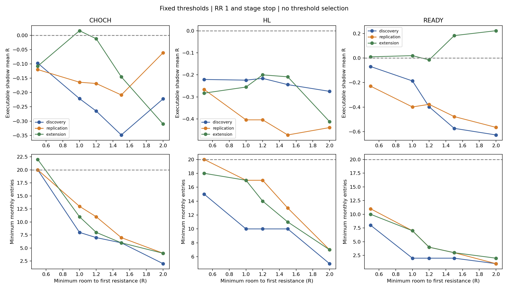

# 抵抗までの上値余地：M5の3波 × M1の3波

## 結論

**「最初の抵抗まで1.2R以上」という条件は、今回の固定候補では採用を見送る。** CHoCHの実行可能回数は月7〜17回となり、最低月20回を満たさない。平均Rも3期間とも負だった。

**0.5R以上ならCHoCHは月20〜33回を残せるが、平均Rは -0.097 / -0.120 / -0.108。** 頻度は残るものの、正期待値にはつながっていない。これを最適値として採用しない。

抵抗数・クラスター数にはREADYで3期間とも平均Rが正の小区分が2つあった。ただし月3〜13回、または月1〜5回と少なく、95%区間もゼロを含む。**正期待値と毎月20回を両立する区分は確認できなかった。** 現行EA・Sharedへのフィルター追加や閾値最適化は行っていない。

## 1. 固定した比較対象

- 2025年1〜3月（discovery）、5〜7月（replication）、8〜10月（extension）の9か月。
- 前回と同じ769主候補：CHoCH 382、初回HL 228、READY 159。HL更新を含む生記録は972候補。
- 入口のAsk、SL、RR1の仮想損益を変更せず、抵抗情報だけを追加。2種類のSL基準を分けて比較。
- `STAGE`：CHoCHはM1転換安値、HL/READYはその時点のHL。`REVERSAL_CONTROL`：全段階で転換安値。SLバッファ10points。
- **距離条件の1.2RはTPのRR変更ではない。** TPは従来のRR1のまま。損益にはBid/Ask差を含み、手数料・スワップ・追加遅延等は未反映。

[事前計画](plan.md)。期間も価格閾値も追加探索していない。これらの期間は既に見た研究データであり、新規OOSではない。

## 2. 抵抗の定義

| 記録対象 | 定義 |
|---|---|
| M5 Wave1 High | 元候補の構造アンカー。符号付き距離Rと、突破済み／上方抵抗として有効かを別に保存 |
| その上のM5高値 | Wave1 Highより厳密に上、かつ候補Ask以上にある最も近い未突破高値 |
| M15高値 | 候補Ask以上の最も近い未突破M15高値 |
| H1高値 | 候補Ask以上の最も近い未突破H1高値 |
| ラウンドナンバー | 候補Ask以上で最も近い .00 / .50。Askと同値なら0R |

距離Rは `(抵抗価格 − 候補Ask)/(候補Ask − SL)`。新しいswing highは左右2本より厳密に高い確定ピボットとし、同値は不採用。右2本が閉じる前は使用しない。

**未突破はヒゲ基準。** 高値足以後に一度でも厳密に上抜いていれば、その後戻ってきても未突破高値として再採用しない。同値接触は突破としない。候補までの閉じたM1足で部分上位足内の突破も調べ、候補の最初のBidも確認する。未確定の将来高値は使わない。

「最初の抵抗」は、有効なWave1 High・上記M5/M15/H1群・ラウンドナンバーの最小価格。強さを将来の反転結果で選んではいない。Wave1 Highが過去にヒゲで突破済みなら、この最初の抵抗の集合から外すが、Wave1 High自体の距離・状態は残す。元の売買構造の終値ブレイク判定とは別の研究用記述で、候補自体は削除していない。

探索範囲は確定M5の1800本、M15/H1の800本。見つからない場合は`NOT_FOUND_WITHIN_LOOKBACK`とし、無限の余地とは解釈しない。ラウンドナンバーは再訪しても存在する価格格子として扱う。

### 抵抗数とクラスター

- 1R / 1.2R / 1.5R / 2R以内の、**異なる価格の水平線数**を記録。同じ価格のM5/M15/H1を3本とは数えない。
- 別に、その水平線に寄与するM5/M15/H1/RNの種類数を保存。同TF・同価格の複数ピボットも重複させない。
- クラスター幅は**0.05円（5pips）固定**。価格順の非重複グループで最高−最低が0.05円以内。隣同士が近いという理由で幅を連鎖的に広げない。
- 異なる2種類以上の寄与があればクラスターとする。同TF高値2個だけでは該当しない。各R範囲にはクラスター下端が入った時点で算入し、上端価格も台帳へ記録。
- 同じ山がM5とM15の両方の高値になる場合がある。「2種類」を独立した2つの証拠とは扱わない。

## 3. CHoCH：最初の抵抗までの距離

以下はSTAGE SL、距離条件を先に適用した後、1ポジション・約定から15分クールタイム・同じM5親波1回で再生した結果。月範囲は9か月全体、平均Rは各3か月。

| 最低距離 | 実行数合計 | 月別実行回数 | 1〜3月 平均R | 5〜7月 平均R | 8〜10月 平均R |
|---|---:|---:|---:|---:|---:|
| 無条件 | 326 | 28〜49 | -0.108 | -0.138 | -0.119 |
| 0.5R以上 | 221 | 20〜33 | -0.097 | -0.120 | -0.108 |
| 1.0R以上 | 128 | 8〜20 | -0.221 | -0.164 | +0.016 |
| **1.2R以上** | **99** | **7〜17** | **-0.265** | **-0.169** | **-0.012** |
| 1.5R以上 | 76 | 6〜15 | -0.348 | -0.209 | -0.145 |
| 2.0R以上 | 41 | 2〜9 | -0.222 | -0.061 | -0.310 |

距離を広く取るほど期待値が改善する、という単調な関係は見えない。8〜10月の1.0R以上は僅かに正だが、他2期間では負だった。

### 1.2R以上の月別回数

| 月 | CHoCH実行数 |
|---|---:|
| 2025-01 | 14 |
| 2025-02 | 8 |
| 2025-03 | 7 |
| 2025-05 | 12 |
| 2025-06 | 17 |
| 2025-07 | 11 |
| 2025-08 | 13 |
| 2025-09 | 9 |
| 2025-10 | 8 |

382候補のうち距離条件で268候補が外れ、114候補が残る。その後、同じ親波の重複で14、保有中で1が外れ、99回となる。**回数減少の主因はクールタイムではなく距離条件そのもの。**

| 期間 | 1.2R以上の実行数 | 勝率 | 平均Rの95%区間 | 60分MFE / MAE |
|---|---:|---:|---|---|
| 1〜3月 | 29 | 37.9% | [-0.616, +0.087] | 1.572 / 1.524R |
| 5〜7月 | 40 | 42.5% | [-0.475, +0.142] | 1.548 / 1.687R |
| 8〜10月 | 30 | 50.0% | [-0.352, +0.328] | 1.607 / 1.413R |

MFE/MAEは決済後も含む固定60分の極値であり、同じ取引で獲得できた利益という意味ではない。決済までのMFE/MAEもCSVへ保存している。



## 4. HL・READY、抵抗ごとの距離

### 最初の抵抗まで1.2R以上（STAGE）

| 段階 | 各期間の実行数（1〜3 / 5〜7 / 8〜10月） | 各期間の平均R | 全9か月の月別範囲 |
|---|---|---|---|
| CHoCH | 29 / 40 / 30 | -0.265 / -0.169 / -0.012 | 7〜17 |
| HL | 46 / 52 / 46 | -0.216 / -0.404 / -0.200 | 10〜24 |
| READY | 13 / 19 / 20 | -0.398 / -0.378 / -0.015 | 2〜8 |

HLはR換算の余地が大きくなりやすいが、HL基準の狭いSLの影響も含む。両SL基準で同じ候補の最初の抵抗価格は一致している。Rの変化を価格上の余地だけの効果と解釈しない。

### 抵抗を個別に見た場合

CHoCH・STAGE・各対象まで1.2R以上を個別に比較すると、M15だけなら各期間の月最少20 / 20 / 22回、H1だけなら25 / 28 / 29回、RNだけなら24 / 27 / 27回は残る。しかし平均Rは次のとおり、すべて負。

| 距離対象 | 1〜3月 | 5〜7月 | 8〜10月 |
|---|---:|---:|---:|
| M15未突破高値 | -0.116 | -0.162 | -0.161 |
| H1未突破高値 | -0.117 | -0.133 | -0.150 |
| .00 / .50 | -0.083 | -0.196 | -0.072 |

Wave1 High、その上の未突破M5高値も含め、**指定した距離の累積条件で3期間すべて平均Rが正の区分は、どの段階・SL基準にもなかった。** [全距離の期間比較](threshold_stability.csv)

CHoCHの最初の抵抗には、382候補中286候補でM5高値が含まれた。RN単独は76、M15単独は20。遠いH1高値まで余地があっても、途中のM5高値が先にあることが多い。これは抵抗の配置についての記述で、そこで必ず反転するという証明ではない。

## 5. 抵抗数・クラスター数

1R / 1.2R / 1.5R / 2R以内について、事前固定の0 / 1 / 2以上だけを比較した。クラスター幅は変更していない。

3期間とも平均Rが正だったのは次の2区分。ただし全て小標本で、95%区間はゼロを含み、月20回に届かない。

| 区分 | 件数（1〜3 / 5〜7 / 8〜10月） | 平均R | 月別範囲 |
|---|---|---|---|
| READY・STAGE：1.2R以内の異なる抵抗価格が1個 | 19 / 26 / 15 | +0.152 / +0.060 / +0.050 | 3〜13 |
| READY・REVERSAL_CONTROL：2R以内にクラスターなし | 7 / 10 / 12 | +0.428 / +0.144 / +0.134 | 1〜5 |

「抵抗が1個なら最適」「クラスターなしなら安全」とは結論しない。例えばCHoCHの1.2R以内に抵抗が1個の区分は、平均+0.142 / -0.210 / -0.374Rと再現しなかった。CHoCHのクラスターなしも全3期間で負だった。

**抵抗が少ないほど良い、という一貫した関係は確認できていない。** [抵抗数・クラスター数の全期間比較](count_stability.csv)

## 6. 判断と次に検証する仮説

1. **first resistance >=1.2Rの採用は見送る。** 期待値と頻度の両方で目的を満たさない。1.0/1.5/2.0へ近傍最適化を続けない。
2. **0.5R以上も採用しない。** 最低月20は残るが、利益の根拠がない。他フィルターを重ねれば20回を割る余地も大きい。
3. **READYの抵抗1個／クラスターなしは、弱い再確認候補にとどめる。** 小区分の方向一致であり、頻度目標を解決しない。追うなら閾値を動かさず未使用期間で確認する。
4. **次の研究課題は距離よりも、抵抗への到達・通過の違い。** 「抵抗まで届かずSL」「抵抗に届いて反転」「抵抗を通過」を将来の評価ラベルとして分け、候補時点の情報と対応させる価値はある。ただし今回は未実施で、将来の反応を入口条件へ混ぜない。

今回分かったのは、**上値余地の比率だけでは、そこまで進む確率も、抵抗を抜ける確率も保証されない**という、この候補群における結果。すべての戦略で上値余地が無意味だという結論ではない。

## 7. データ・検証・制限

- MT5の読み取り専用スクリプトからM1 405,373本、M5 81,211本、M15 27,072本、H1 6,768本を出力。エクスポートは0エラー・0警告、取得失敗0、発注0。
- 過去のnative M15/H1バー27,999行のOHLCと一致。候補のM1終値とM5 Wave1価格も一致。
- 確定待ち、同値、突破後の再下降、部分足内突破、RN境界、同価格重複、クラスター連鎖等の11ケースに合格。
- 実候補21点で履歴を物理的に切った比較、さらに21点で未確定・未来足の高値を極端な値に変更した比較を行い、全特徴量・抵抗台帳が不変。
- 保存した35,327個の高値抵抗を、上位足の累積最大値とは別にM1高値から照合し、未突破を確認。7,776件の範囲別個数を照合。
- 18通り（3期間×3段階×2SL）の無条件実行台帳は前回と完全一致。条件別採用26,840レコードについて、親波重複・同時保有・15分違反なし。この検査件数を独立取引数とは数えない。
- 抵抗特徴量と主要集計11ファイルは再実行でバイト一致。候補と結果・現行ソースのハッシュも保存。
- 今回は新EAの売買バックテストではなく、前回のModel4由来の固定仮想損益への特徴量付与と時系列再生。最大保有240分等の前提は前回と同じ。実約定拒否、証拠金、手数料等を含む口座損益ではない。
- 元データの3月27日には実ティック欠損・不整合による生成代替警告がある。過去に見た期間、小標本、多重比較、親波間の時間依存も制限。信頼区間は親波クラスタを固定乱数で1000回再標本化した探索的区間。
- 有限の高値探索範囲、厳密なヒゲ突破の定義、5pipsクラスター幅の結果である。これらの定義を動かす感度探索は今回していない。

[取得ログ](export.log)、[特徴量監査](feature_audit.json)、[独立監査](independent_audit.json)、[元の実行台帳との照合](analysis_audit.json)、[再実行一致](analysis_reproducibility.json)

### 開始時に見つかった既存変更

前回研究後、SharedとInputsに終値ピボット／HL省略オプションが追加されていた（初期値は双方false）。その既存変更は保存し、本作業では変更・再コンパイルしていない。[開始時差分](preexisting_shared_changes.diff)、[開始時ハッシュ](baseline_manifest.json)。今回の769候補は前回の固定データであり、追加オプションを有効にした別戦略の結果ではない。

## 8. 成果物と再実行

**769候補をそのまま見るなら [primary_candidates_stage.csv](primary_candidates_stage.csv)。** 絞り込み不要。2種類のSLとHL更新も見るなら[candidates_with_resistance.csv](candidates_with_resistance.csv)を使い、`primary=True`と`stop_basis`で分ける。

| ファイル | 内容 |
|---|---|
| [threshold_tables.md](threshold_tables.md) | CHoCH/HL/READY・両SLの指定距離条件、勝率、R、MFE/MAE、実行回数 |
| [resistance_statistics.csv](resistance_statistics.csv) | 5対象と最初の抵抗、距離区分、個数区分の全統計 |
| [monthly_execution_counts.csv](monthly_execution_counts.csv) | ゼロ月を含む月別候補・実行回数 |
| [execution_ledger.csv](execution_ledger.csv) | 指定距離条件ごとの採用・拒否理由 |
| [resistance_features.csv](resistance_features.csv) | 損益ラベルを含まない抵抗特徴量 |
| [resistance_levels.csv](resistance_levels.csv) | 各抵抗の価格、種類、ピボット時刻、確定時刻、距離R |
| [resistance_clusters.csv](resistance_clusters.csv) | クラスターの下端・上端・寄与種類 |
| [feature_distributions.csv](feature_distributions.csv) | 各特徴量の分位点・欠損数 |
| [data_dictionary.md](data_dictionary.md) | 列名・行数・重複と集計上の注意 |

研究コードは `tools/swing_structure/three_wave_resistance.py`、`build_resistance_features.py`、`analyze_three_wave_resistance.py`、`audit_three_wave_resistance.py`、`summarize_resistance_counts.py`。native取得は `mql/Scripts/tests/ThreeWaveResistanceExport.mq5/.ex5` と `tools/swing_structure/run-three-wave-resistance-export.ps1`。

```powershell
python tools/swing_structure/build_resistance_features.py
python tools/swing_structure/analyze_three_wave_resistance.py
python tools/swing_structure/summarize_resistance_counts.py
python tools/swing_structure/audit_three_wave_resistance.py
```

保存済みの価格データから再集計できる。現行EA・Shared・前回研究ファイルは変更不要。
