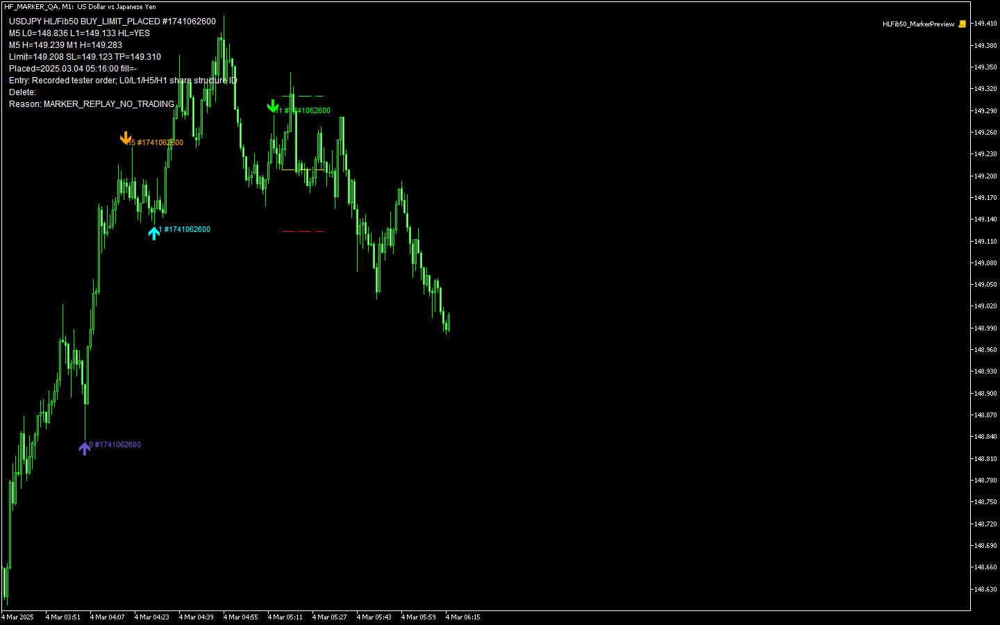

# USDJPY M1/M5 Higher Low・50% Buy Limit 検証版

## 最終結果（2026-09-21）

EA、ネイティブ単体テスト、マーカー再現スクリプトはコンパイル **0 errors / 0 warnings**。MT5実行の単体テストは **44件成功・失敗0件**。

ユーザー承認済みの既存口座設定を独立した一時MT5で使用。実口座の自動売買を無効にし、売買テストはストラテジーテスター内で実施した。

| 検証 | 通常：発注時SL/TP | フォールバック：約定後SL/TP |
|---|---:|---:|
| M1判定 | 7,189 | 7,189 |
| Buy Limit設置 | 23 | 23 |
| 約定 | 13 | 13 |
| 15分期限取消 | 5（サーバー） | 5（EA） |
| 新M5構造による取消 | 5 | 5 |
| 約定後SL/TP設定成功 | 対象外 | 13 |
| 自動監査の違反 | 0 | 0 |

MT5 build 6182、USDJPY M1、2025-03-03～03-07（終了指定03-08）、初期資金10,000 USD、レバレッジ100。Model=0の生成Every Tick、1,582,916ティック。**実ティック検証ではない。収益性・実運用適性は判定していない。**

証拠：[監査集計](audit_summary.json)、[通常診断CSV](normal/diagnostics.csv)、[通常テスターログ](normal/tester.log)、[フォールバック監査](deferred/audit.json)、[単体テスト](unit_runtime.log)、[EAコンパイル](ea_compile.log)。初期失敗試行の `initial_old_binary/` は最終結果に含めない。

## 採用した時系列・状態

1. 左右2本（入力変更可）の厳密な高値・安値比較。同値を除外し、現在足を使わず右確認足が閉じてから利用する。
2. 最新M5安値2点が Higher Low。新安値の確定時点で利用可能な最新確定M5高値を固定する。
3. 新安値が確定した時刻以降に始まるM1足だけで、固定高値を下側から上側へ通過したことを確認する。過去の上側にある高値だけでは成立しない。
4. 通過後のM1高値ピボットが確定した新M1足で、50% Buy Limitを一度だけ設置する。
5. 新構造・安値割れ・期限で未約定注文を取消。初回約定から900秒のクールタイムを開始する。

`WAIT_FOR_STRUCTURE → BULLISH_STRUCTURE_CONFIRMED → WAIT_FOR_M1_BREAKOUT → BREAKOUT_CONFIRMED → WAIT_FOR_50_PERCENT_PULLBACK → BUY_LIMIT_PLACED → POSITION_OPEN / COOLDOWN`。無効化・使用済み・復旧不整合は専用状態と理由を記録する。判定は新M1足の1回だけ。データ不足時に同じ足の後続ティックで再判定しない。

既存インジケーターと `ConfirmedPivot.mqh` は変更していない。バッファ0～3は上位高値/安値・下位高値/安値、4～7は対応する確定時刻。価格はピボット足に遡って配置されるため、EAで利用する際は確定時刻の検査が必要。今回は同じ共通ヘッダーをEAで直接使用し、iCustomの非同期更新待ちとM1への投影を介さず元の時刻を扱う方式を採用した。

## 注文の根拠マーカー

`InpShowMarkers=true`。同じ構造IDを付けた4点と価格線を表示する。

| ラベル | 意味 |
|---|---|
| L0 | 古いM5安値 |
| L1 | 新しいM5安値・フィボナッチ下端 |
| H5 | L1確定時に固定した上抜き対象M5高値 |
| H1 | ブレイク後の確定M1高値・フィボナッチ上端 |
| FIB50 / LIMIT / SL / TP | 計算した価格・注文の保護価格 |

矢印ツールチップにピボット時刻と確定時刻を表示。注文時の4点をHF3ジャーナルに保存し、同一端末での再起動時も元の注文根拠を再描画する。

画像はテスター診断CSVの注文1件を、実際のUSDJPY履歴162本の専用カスタムシンボルへEA自身の描画関数で再現したもの。ビジュアルテスターからの直接撮影ではない。描画スクリプトの発注APIは無効化済み。

### 成立例（MT5サーバー時刻）

2025-03-04：L0=148.836（04:05）、L1=149.133（04:30、04:45確定）、H5=149.239（04:20、04:35確定）。05:02の上抜き後、H1=149.283（05:13）が05:16に確定。

05:16に **Buy Limit 149.208 / SL 149.123 / TP 149.310 / 1.75 lot**。10,000 USD Equityに対し想定損失99.75 USD。05:21:39に約定。価格はTick Sizeに丸めるため理論50%・1.2Rとの微差がある。[元の注文行](marker_example.csv)

非成立例は [通常の抽出例](normal/examples.csv) を参照。Higher Low不成立、確定後の上抜き待ち、M1高値未確定、安値割れ、クールタイム、既使用構造、指値のブローカー距離不足を区別して記録している。

## 実装と差分

- [EAソース](../../../mql/Experts/USDJPY_M1_M5_HL_Fib50_Long.mq5) と同名EX5。
- [構造・価格計算ヘッダー](../../../mql/Include/SwingStructure/HLFib50.mqh)。既存ピボットヘッダーを共用。
- [ネイティブ単体テスト](../../../mql/Scripts/tests/HLFib50_Validation.mq5)、[描画再現](../../../mql/Scripts/tests/HLFib50_MarkerPreview.mq5)。
- [独立テスター実行スクリプト](../../../tools/swing_structure/run-hf-validation.ps1)、[CSV監査](../../../tools/swing_structure/audit_hf_validation.py)。
- [再開時点からのEA差分](resume_changes.patch)。OrderCheckは戻り値trueかつretcode=0も正常として扱う一方、false/0は拒否。期限方式を入力で分離し、リスク丸めの許容誤差を厳密化した。

`InpRewardRisk` 入力は再開時点で存在したため保持し、今回のプリセット・検証では指定どおり **1.2** に固定した。SLバッファ初期値10 points。銘柄仕様と口座通貨換算はOrderCalcProfitで反映し、最小ロットを超えるリスクなら見送り、刻みは切り下げ、証拠金不足時は縮小または見送る。

## MT5での確認手順

1. ナビゲータを更新し `Experts/dev/mql/Experts/USDJPY_M1_M5_HL_Fib50_Long` を選ぶ。同名EX5は作成済み。
2. ストラテジーテスターで銘柄を厳密に `USDJPY`、時間足M1、上記期間・Every Tick・USD資金に設定する。
3. [通常プリセット](normal/hf_normal.set) を読み込む。RR=1.2、SL buffer=10、マーカー有効、`InpTestDeferredProtection=false` を確認する。
4. ビジュアルモードでL0/L1/H5/H1の同じIDとLIMIT/SL/TPを確認する。H1の確定前に指値がないこと、注文設置後15分の取消、約定後15分の見送りをログと突き合わせる。
5. フォールバックは [専用プリセット](deferred/hf_deferred.set) をテスター内だけで使用する。この強制テスト入力はテスター外では初期化拒否する。
6. 自動監査はリポジトリで `python tools/swing_structure/audit_hf_validation.py`。独立テスター再実行には専用TEMP端末と接続設定が必要。共有成果物のINIには口座設定を含めない。

## 既知の制限・未検証

- 実ティック、OOS、デモフォワード、実口座は未検証。1%は発注時の予定SL損失であり、手数料・ギャップ・スリッページ・待機中Equity変化を含む実損失の上限保証ではない。
- フォールバック約定後の保護成功はテスターで13件確認。保護失敗時の決済、通信応答不明、部分約定残注文取消、ジャーナル復旧はネイティブ実行のモックで確認した。実ブローカーの拒否・通信断・本物の部分約定や実保有を伴う端末再起動は未検証。
- 裸注文のフォールバック中にEA停止・通信断があるとSL/TP設定を保証できない。静的に不可能なストップ距離は裸注文で回避せず見送る。保護設定失敗時は既存ロングの決済を試みる。
- 期限指定が使えないGTC注文の取消はEA稼働・接続に依存。Freeze Level等による取消失敗は理由を記録し再試行する。
- 再起動ジャーナルは同一端末用。別PC・別端末から同一Magicで同時運用する排他は保証しない。旧HF2記録は価格等を復旧するが4点マーカー情報を持たない。
- `USDJPY` 完全一致のみ。接尾辞付き銘柄は対象外。他者のUSDJPY注文・保有があれば新規を抑止し、自分の注文・保有は原則1件ずつまで。予期しない複数保有や所有権不整合は要確認。
- 同時に高安両方となる曖昧なピボットは売買構造に採用しない。稼働開始前の古いシグナルを再発注しない。履歴訂正・履歴欠落までリアルタイムとテスターの一致を保証するものではない。
