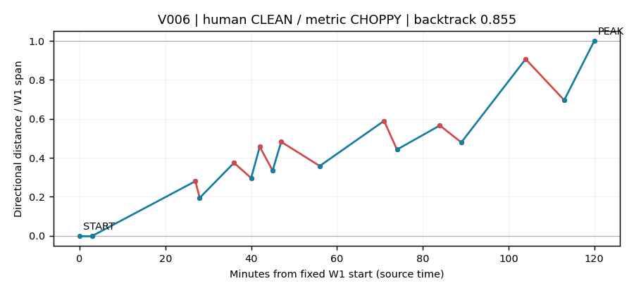

# ①内部の往復診断：実装完了、除外条件への採用は見送り

前回の「目視で往復が多い①」を機械判定するため、定義を一つだけ固定して実装した。60画像の分類再現ゲートは未通過。したがって取引除外は追加せず、未使用期間の成績比較にも進めていない。既存EA・元の年間バックテストは変更していない。

- [60件の診断画像と元画像を比較する](index.html)
- [固定計画](../../../knowledge/experiments/2026-10-24-wave33-chop-diagnostic-plan.md)
- [固定した混同行列と全60件](agreement.json)
- [年間440件の診断値（損益を含まない）](features.json)
- [独立した原本からの再計算](audit/independent_recompute.json)

## 唯一の定義

下位足の確定高安を①起点から終点まで順につなぎ、①と逆方向へ戻る価格差を合計する。その合計を①幅で割り、**0.5以上ならCHOPPY、0.5未満ならCLEAN**。既存の①起点・終点をそのまま使い、起点の定義やエントリー条件を同時に変えていない。

例：①が10ドル進む間に、途中で合計5ドル以上戻ればCHOPPY。全ティックの変動ではなく、確定スイングを整理して結んだ経路の測定。比率の分母は①幅であり、SL幅の1Rではない。

注文より前のイベント行で発行済みのpivotだけを使用。同じ時刻でも後の行は除く。①の元足範囲に同一足の高安両方のpivotがあるときは、足内順序を想像せず判定不可とした。同種pivotの連続は極値へ整理する。内部に確定pivotがまだない場合は、入力履歴が範囲全体を覆うなら直線経路として扱う。

## 60画像との一致

人の分類は前回固定したCLEAN35件、CHOPPY25件。今回は勝敗ラベルを判定・集計に使っていない。

| 前回の人の分類 | 同じ判定 | 反対の判定 | 判定不可 | 再現率 |
|---|---:|---:|---:|---:|
| 素直な①：35件 | 13 | 17 | 5 | 37.1% |
| 往復が多い①：25件 | 19 | 2 | 4 | 76.0% |

事前に固定した合格基準は、両方の再現率が70%以上。判定不可を分母から外していない。全体の一致は32/60件（53.3%）、計算可能は51/60件。**往復の多い①は拾えるが、素直な①も多く弾くため不採用**とした。

年間440件の診断はCHOPPY247件、CLEAN107件、判定不可86件。全ての判定不可は同一元足の高安順序の曖昧さによるもの。これは成績別の集計ではなく、勝率・利益改善を示す結果ではない。元の60画像では下位足の表示窓外だったV037/V059も、今回は完全な原本履歴から計算した。

## 具体的に何がずれるか

[V006の元画像](../w33entry60/charts/V006.png)は、上位足では比較的素直に下降する①と評価されている。しかし下位足の小さな戻りを合計すると0.855となり、今回の指標はCHOPPYにする。少なくともこの例では、細かい押し戻りの累積と、人が見る波全体の素直さが一致していない。

対照として[V005](charts/V005.png)は人も指標もCHOPPY、[V016](charts/V016.png)は両方CLEAN。この違いを含め、60件を差し替えずに保存した。結果に合わせて0.5の閾値や計算法を変更していない。

## MT5で使う新しいEA

新規ファイル：`mql/Experts/Wave33ChopDiagnostic.mq5`（v1.81）。現行v1.80のコピーへ独立した観測処理を足し、元の `Wave33VisualVerifier.mq5` と共有エンジンは変更していない。[コピーと差分の記録](source_copy_manifest.json)。

- `InpChopDiagnostic=true`：独立した診断CSVを出力。売買を止めるフィルターは実装していない。
- `InpChopLabels=true`：判断可能時刻に小さな診断文字を表示。文字を減らしたい場合はfalseにできる。
- `InpPattern`：M15×M5 / M5×M1を選択。
- `InpEnableTesterOrders`：従来どおり初期値false。trueならテスター内だけで元の売買を行う。
- `InpKeepObjects`：従来どおり描画の保持を選択。

テスターでは新しい `dev\\mql\\Experts\\Wave33ChopDiagnostic.ex5` を選ぶ。表示チャートは下位足、ビジュアルモードを推奨する。既存の左上固定パネルや無限水平線は増やしていない。診断文字の位置はその評価を知り得た日時であり、過去の①終点時刻へ遡って表示しない。

共通Filesフォルダーへ `<解決済み実行タグ>_chop.csv` が出る。計算法・固定閾値・setup_id・①revision・評価イベント・評価時刻・元足時刻・既知時刻・使用pivot・逆行合計・①幅・判定不可理由を保存する。ピーク確定時とORDER時の診断は別行で、以前の診断を上書きしない。元のevents CSVと売買ロジックはそのまま。

## 検証証拠と限界

- [コンパイルログ](compile/)：新規EAと合成ハーネスを `scripts/compile.ps1` で確認。
- [ネイティブ検証の最新結果](native_latest.json)：注文機能を持たない合成ハーネスと、同じ60件のMQL/Python計算照合。隔離した専用テスターを使用。
- [独立監査](audit/independent_recompute.json)：Decimalによる別実装が全440件の値・分類と60件の混同行列を再現。SIGNAL時点とORDER時点の計算も全440件で一致。
- [ネイティブ経路の別照合](audit/native_path_parity.json)：計算可能51件は比率・逆行合計・①幅だけでなく、経路の元足時刻・既知時刻・価格・高安種別も照合。残り9件は判定不可という分類が一致。
- [保護ファイルと計画のハッシュ](baseline.json)：元のEA/EX5/共有ヘッダー12ファイルを保護。

ネイティブ検証は数値計算24項目と60事例が全て通過。描画プロパティは11項目中10項目が通過した。**ツールチップに保存したsetup_id全文の読み戻しは未解決**で、ビジュアルモードの最初のOnTickで再描画しても空文字が返った。表示そのものや実際のマウスホバーで全文が見えることは今回保証しない。根拠の全情報は別CSVへ残している。元の比較画像60件は再構成図であり、MT5画面60枚の直接キャプチャではない。

非ビジュアルテスターの描画プロパティには制限があるため、数値試験とは分けてビジュアルモードも試した。[MetaQuotes公式のテスター描画制限](https://www.metatrader5.com/en/terminal/help/algotrading/testing_features)。文字列プロパティ設定の成功はキュー投入の成功を意味するため、設定関数がtrueでも読み戻しを合格とはしていない。[ObjectSetString公式仕様](https://www.mql5.com/en/docs/objects/ObjectSetString)。失敗した試験もnative配下に保持する。

元データは既観測2020年の生成ティック検証。実ティックの注文精度、新しい取引フィルターの収益性、未使用期間への再現性は今回の合格対象ではない。画像分類の再現に失敗したため、それらの評価へ進めず、この定義の診断ツールとして保存した。
