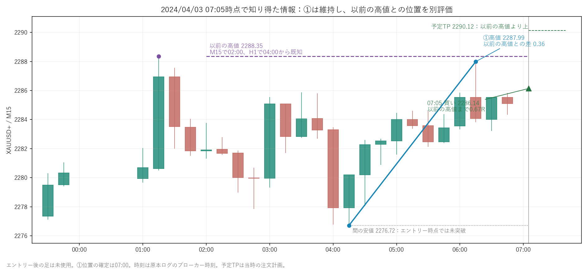

# ①の認識を維持し、以前の高値との位置関係を別評価する

ユーザー画像に対応するXAUUSD+の2024年4月3日07:05買いを、ORDERより前の原本情報だけで点検した。①が悪い形という問題ではなく、①が以前の高値付近に再到達したという環境情報を十分に表現していない例だった。今回EAの取引ロジックは変更していない。

[元データを抽出した記録](case.json)にはORDERの行順、確定済み高値の元足時刻と既知時刻、当時のM15確定足、元ファイルSHA256を保存した。エントリー後の足を使用していない。再現用：[prior_high_case.py](../../../tools/wave33_visual/prior_high_case.py)。

## この取引で既に分かったこと

| 判断材料 | 値・時刻 |
|---|---|
| 以前の高値 | 2288.35 |
| M15での位置／既知時刻 | 01:15の高値／02:00から確定済み |
| H1での位置／既知時刻 | 01:00足の高値／04:00から確定済み |
| ①起点 | 04:15、2276.72 |
| ①高値 | 06:15、2287.99。07:00に確定認識 |
| 以前の高値との差 | 0.36（①幅11.27の約3.2%） |
| 買い | 07:05、2286.14 |
| SL／予定TP | 2282.83／2290.12 |
| 以前の高値までの余地 | 約0.668R |
| H1方向の記録 | WITH_H1 |

M15とH1の2288.35は同じ市場の値動きであり、別々の2回の反発として数えない。時刻はブローカー／ソース時刻で、JSTとは主張しない。

## 現在の認識が足りない理由

`H1Direction()` は直近2高値・2安値の切り上げ／切り下げを分類するだけ。この例のWITH_H1は、その計算上は整合している。しかし「以前の高値に接近している」という位置情報は表さない。

`Obstacle()` は利益方向にある最も近いスイングを一つだけ選ぶ。この例では①高値2287.99をWAVE1として保存した。少し上にある以前の高値2288.35と①の重なりを別状態として残していない。実行設定のobstacle_modeは表示のみだった。現在の既知スイング候補には以前の高値も存在しているため、元データがないのではなく、環境として組み合わせる処理がない。

前の高値まで約0.67Rに対し予定TPは約1.20R。①が伸びても、TPまでに以前の高値を通過しなければならない状況だった。これはその後の下落を使わずに説明できる。

## ダブルトップ候補と完成を混同しない

エントリー時点では、二つの高値の間の安値2276.72を下抜けていない。したがって、売りの完成パターンとして下落を先取りするのでなく、「同じ高値圏への再接近で買いが止まる懸念」という診断が適切。一般的なダブルトップの確認も、二つの高値の間の安値を割ることによる。[CME Groupの反転パターン解説](https://www.cmegroup.com/education/courses/technical-analysis/technical-patterns-reversals)。

## 次に一つだけ加えるなら

**「①より前に形成され、当時すでに確定していたM15/H1高値帯への再到達」**を、①の認識や往復指標とは独立した環境診断にする。ショートは以前の安値で対称に扱う。

保存するのは、以前の高値の出所・位置・既知時刻、①高値との差、エントリーからの距離R、TPとの前後関係、上位足の確定終値が帯の上へ出ているか。描画は出所の高値と①を結び、判断可能時刻以降の有限の帯・線にする。

「同じ高値付近」の幅、必要な時間間隔、中間の調整の大きさは、この一画像で最適化して確定しない。まず候補の表示が本人の認識と合うか点検し、その後に任意の見送り条件を一つ比較する。H1方向が逆なら全面禁止という条件や、①の認識変更は今回の意図に含めない。
