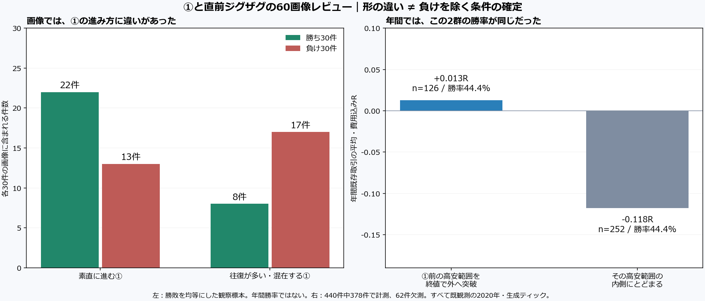

# ①と直前のジグザグ：勝ち30件・負け30件の画像分析

**60件の画像を実際に観察した。負け画像には「①内部の往復が多い」形が多かったが、年間全件へそのまま移せる負け除外条件はまだ見つかっていない。別に、EAの確定スイング起点と、①区間の実際の最安値/最高値がずれる37例を発見した。まずは①の意味を人の波認識と照合する対象として残す。**

[画像ギャラリー：全60件](index.html)では、勝敗と観察メモを初期状態で隠し、A/B・方向で絞って画像を開ける。ボタンで結果と記録を開示できる。[全60件の観察・日時・損益CSV](analysis/visual_annotations_unblinded.csv)も保存した。画像はMT5直接スクリーンショットではなく、原本の確定足とORDER情報から作った再構成図。エントリー後の足は描いていない。

## 画像で見えた特徴

個別の勝敗・損益・決済後の動きを隠し、奇数30件と偶数30件を別担当が全件の個別画像で観察した。全60件の判定と追加6件の確認判定を[ハッシュで固定](reviews/blind_frozen.json)してから勝敗を開示した。担当は過去の年間概要を知っており、厳密な臨床的二重盲検とは呼ばない。

| 観察した形 | 勝ち30件の中 | 負け30件の中 |
|---|---:|---:|
| ①が素直に進む | 22 | 13 |
| ①内部の往復が多い／混在 | 8 | 17 |
| ①前に持続的な逆方向トレンド | 9 | 9 |

「往復が多い①」は今回の負け画像に多かった。ただし素直な①でも13件は負け、往復する①でも8件は勝ち。直前が明確な逆トレンドかどうかだけでは勝敗が分かれなかった。`RANGE_OR_MIXED`にはレンジだけでなく同方向トレンドからの継続形も含むので、混在40件を全て「レンジ」と数えない。

画像での「素直さ」を、終値の進み方の効率だけで機械化すると同じ関係を再現しなかった。終値効率0.6以上の196件は平均−0.155R。①の大きさだけでも「大きいほど良い」という単調な関係はなかった。良く見えた特徴に合わせて後から閾値を作り直していない。

6件の追加確認では、担当間の一致は①の進み方4/6、事前構造4/6、前範囲突破6/6。全60件を2名ずつ評価した試験ではなく、主観的な形の分類には限界がある。[判定の全対応](analysis/root_agreement_pairs.csv)。

## 前の高安範囲を抜いた①なら負けにくいか

主項目を先に「①の区間で、①より前の既知8pivotの外側へ確定終値が出たか」と固定した。エントリー後の高安や、後から確定するpivotは使わない。

| 年間の既存取引 | 件数 | 勝ち／負け | 勝率 | 平均R |
|---|---:|---:|---:|---:|
| 前範囲を終値で外へ突破 | 126 | 56 / 70 | 44.4% | +0.013 |
| 前範囲の内側にとどまる | 252 | 112 / 140 | 44.4% | −0.118 |
| 既知8点が不足・曖昧で計測不能 | 62 | 26 / 36 | 41.9% | −0.212 |

平均Rには差があったが、**負ける割合は両群で同じ**。突破群の純損益PFは約1.004で、ほぼ損益分岐だった。少なくとも「外まで抜けた①なら負けが減る」とは言えない。出口・利益幅も含む実現Rとの関係であり、入口の勝率改善と同一視しない。A/B・前後半でも平均Rの差の向きは揃ったが、A前半の突破例は3件しかない。LONGの突破群は平均−0.144Rで、改善差は主にSHORTで大きかった。

選んだ画像60件の数値比較では、逆に突破13件の平均−0.203R、内側38件−0.068R。残り380件では差の向きが戻った。勝敗で層化した少数画像から年間の効果を決めないことも確認できた。残り380件も既に見た2020年であり、OOSではない。ALLの合計は独立A/B口座の取引を記述集計したもので、同時運用のポートフォリオ成績ではない。

固定5項目・欠測・A/B・方向・前後半の全数値と、支持しなかった案は[勝敗開示後の分析](analysis/README.md)・[全群CSV](analysis/fixed_feature_groups.csv)へ保存した。利益が出る境界や組合せを探索していない。

## 新しく見つかった①起点の認識差

勝敗を開示する前の画像観察で、「青い①の起点より、その後に出た安値の方が低いLONG」などに複数の担当が気付いた。原本上位足で全440件を点検すると、**37件（A7/B30）**で起点足と終点足の厳密な間に、起点を逆側へ超す価格があった。35件はブレイク足より前、2件はブレイク足そのもの。終点足だけで両側極値がある1件は足内の順番不明として別扱いにした。

元の起点/終点価格は原本の当該足の高安と全件一致し、価格を誤記したものではない。EAはブレイク足のOPEN時点で既知の最後の確定スイングを起点へ採用する。その後にできた新安値/新高値の足があっても、そのスイング確定がまだなら古い確定点が使われる。候補成立後の起点割れは検査する一方、候補成立前の全足を遡って起点を選び直す処理はない。[コードと時刻の説明](audit/origin_code_review.md)。

例えば次の2件は、どちらも起点認識差がある。結果の違う例を両方残す。

| 画像 | 注文日時・方向 | ログの①起点 | ①途中のさらに低い値 | 結果 |
|---|---|---:|---:|---:|
| [V036](charts/V036.png) | 09/01 18:16 LONG | 1969.71 | 1964.24 | −1.019R |
| [V054](charts/V054.png) | 01/24 16:33 LONG | 1557.52 | 1556.56 | +0.970R |

V036の低い足位置は17:45、OHLCが既知になったのは17:50。これは左右2本を待ってスイングが確定する時刻とは別。こうした差は、裁量で見た①の始まりとEAの青線が違う理由になり得る。①幅・Fibにも関わるため、手法再現の点検対象として優先したい。

ただし37件には16勝・21敗があり、Aは悪化群、Bは改善群だった。「その形なら取引しない」を一律に追加する根拠はない。今回追加したのは**意味と時刻の事後監査**で、元の5項目へ紛れ込ませた最適化ではない。EAの不具合・負けの原因とも即断していない。[全37件と結果](analysis/origin_audit/README.md)。

## 選定・因果順序・成果物

- 対象：2020年XAUUSD+、v1.80 A87件/B353件。費用込み194勝/246敗。
- 選定：A/B×LONG/SHORT×WIN/LOSSの8層から時系列の等間隔位置を抽出。各層7〜8件、勝30/負30、A30/B30、LONG30/SHORT30。損益額や形の見栄えで選ばず、seed20261023で中立IDへ並べ替えた。
- 画像：上位足は前8pivot/①起点を含む90〜300本、下位足180本。元足の時刻・closed_at・known_atを区別し、同一ティックの一括処理でORDER後に処理される足も除外。線は判断可能時刻から描く。9画像でpre8不足を明示し、前高安帯を描かず突破範囲を判定不能にした。
- 保存：[全60PNGとハッシュ](charts/render_manifest.json)、[初期の観察記録](reviews/blind_frozen.json)、[選定/原本](data/README.md)、[因果順序と独立監査](audit/README.md)。すべて勝敗と照合した後も原本の注釈を変更していない。
- 再現：`tools/wave33_visual/entry60_data.py`→`entry60_render.py`→注釈固定→`entry60_compare.py`→`entry60_gallery.py`。CLI・入力/出力ハッシュは各manifestを参照。既存のEA・年間原本・旧分析は変更していない。

今回の範囲では、**画像での①の質には調べる余地があるが、現時点で確かな負け除外条件はない**。次の点検対象を一つ選ぶなら、①の起点を「最後の確定スイング」とするか「候補発生までに既知の区間極値」とするかの意味を、同じチャートで比較すること。取引判定を先に変えず、①/Fibの認識差を説明してから実装の採否を決める。

すべて既観測2020年・生成ティックの資料であり、未使用期間の再現性や実ティックの執行確認ではない。今回の画像標本から年間勝率を推定せず、既存約定の差引を新EA成績とも呼ばない。[年間分析との接続](../../backtest/runs/wave33_v180_2020/analysis/README.md)。
