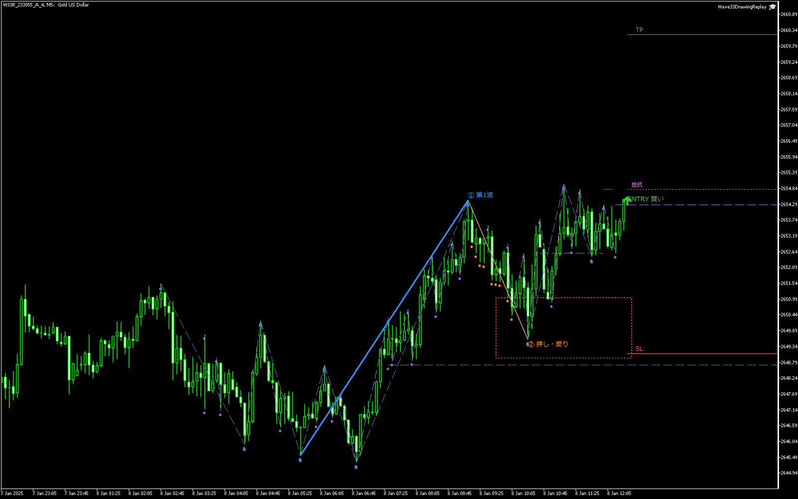

# 3波3波 v1.10 表示改訂

左上の文字が波を隠す、色だけでは認識の流れが分からない、というユーザー指摘を反映した。指定インジケーターの描き方を参照し、山谷を細い破線で結ぶ。売買の条件・候補・実行時刻は変更していない。

## 読む順序

1. **青い太線「① 第1波」**：EAが認定した最初の動き。
2. **オレンジの線「② 押し・戻り」**：第1波に対する調整。オレンジの点線枠はFib38.2～61.8%。
3. **紫の判定線と緑のENTRY**：下位足の転換を待ち、条件成立でENTRYを表示。赤SL・緑TPを併記。

細い青系の破線は上位足、紫の破線は下位足の確定した高安の連結。赤紫は近隣の抵抗／支持。「見送り」には短い理由を出す。青・オレンジの太い脚だけを先に追い、必要なときに細い破線と判定線を見る。

## 初期設定

|入力|初期値|内容|
|---|---|---|
|InpShowInfoPanel|false|大きい左上パネルは廃止。trueでは左下の小さい凡例と詳細tooltip|
|InpDiagnosticLabels|false|細かいスイング・診断文字を通常は省略|
|InpShowSwingPaths|true|確定した山谷を破線で結ぶ|

時刻・ID・詳しい判定理由は各オブジェクトのtooltipと元CSVへ保持する。山谷の点は確定後に実際の足位置へ置く。これは当該足で既に確定していたという意味ではない。tooltipでは元の足時刻、表示時刻、known時刻を区別する。判断用の水平線・トレンドラインは既知時刻からだけ描く。同じ足の高安の先後は推測しない。

## 最終表示例

以下は**通常MT5チャートの記録イベント再生**。元のMT5イベントCSVと、判断時刻までの実XAUUSD M1バーを使用し、注文・シグナルを再計算しない。テスター直接撮影でも動画との一致証明でもない。時刻は元のブローカー時刻。

|パターン・事例|表示の打切時刻|結果|画像|
|---|---|---|---|
|A M15×M5 case0 LONG|2025-01-06 15:45|起点突破による失効|[PNG](examples/A/W33R_85D31F245B7E896A_0.png)|
|A M15×M5 case1 SHORT|2025-01-07 01:15|売りシグナル|[PNG](examples/A/W33R_86D320B758040D4F_1.png)|
|A M15×M5 case4 LONG|2025-01-08 12:30|買いシグナル|[PNG](examples/A/W33R_81D318D8325DE80E_4.png)|
|B M5×M1 case0 LONG|2025-01-06 04:27|買いシグナル|[PNG](examples/B/W33R_AA6D7CB5676CB509_0.png)|
|B M5×M1 case1 SHORT|2025-01-06 13:20|タイムアウト|[PNG](examples/B/W33R_A96D7B2230F9BC5C_1.png)|
|B M5×M1 case4 SHORT|2025-01-06 17:12|売りシグナル|[PNG](examples/B/W33R_A66D76698B9A4EB5_4.png)|

各画像のsetup ID・cutoff・オブジェクト一覧は [A出力](examples/A/render_summary.csv) と [B出力](examples/B/render_summary.csv)。全候補および両パターン各5例の元レビューは [初回資料](../README.md)。描画補助EAは、波全体が画像に入るよう表示倍率だけを調整する。

## 検証証拠

- [最終EAコンパイル](../20261020_232831_482acab8/Wave33VisualVerifier.compile.log)：0 errors / 0 warnings。描画補助EAも [0 errors / 0 warnings](examples/Wave33DrawingReplay.compile.log)。更新EX5はリポジトリのEAと同じ場所へ配置済み。
- [固定区間のMT5 real tick回帰](../20261020_232831_482acab8/review.md)：2025-01-06～18、19候補・5シグナル。全1499行のイベントCSVは改訂前とSHA-256一致。
- [ロジック不変監査](logic_regression_audit.json)：Engine・Types・Ledger・参照インジケーターのハッシュが変更前と一致。
- 両パターン各5例のオブジェクト監査では、パネルとOBJ_LABELは0、山谷の連結703本はすべてSTYLE_DASH・幅1・右延長なし。known／availableが各cutoffより未来のものは0。左延長なしはDisplayの共通描画処理で固定。W1/W2各8例、ENTRY/SL/TP各5例、見送り5例。残る2例はW1終点確定前の失効であり、W1/W2を作らない。
- 最終6例の再監査は1107オブジェクト、破線405本、known付きtooltip682件。パネル0、未来の既知時刻0、W1/W2各6例、ENTRY/SL/TP各4例、見送り2例。画像と同じフォルダのオブジェクトCSVを証跡とする。見送りとW2の反対側anchorはソースで確認した。anchor・左rayはinventoryの収録対象外。

10例のオブジェクト監査は `drawing_review/`、最終の6画像は `examples/`。途中の `preview/`・`native_size_review/` は表示サイズ検討時の記録で、最終画像ではない。画像を大きく要求するだけでは右に余白が増え、実寸要求では隠しチャートの高さが小さかったため、最終は固定画像サイズと波の長さに応じた表示倍率を組み合わせた。

関連する変更理由は [devlog](../../../../docs/devlog/2026-10-20-wave33-display-v2.md)、操作は [検証手順](../../../../docs/validation/wave33-v1-visual-review.md) を参照。
