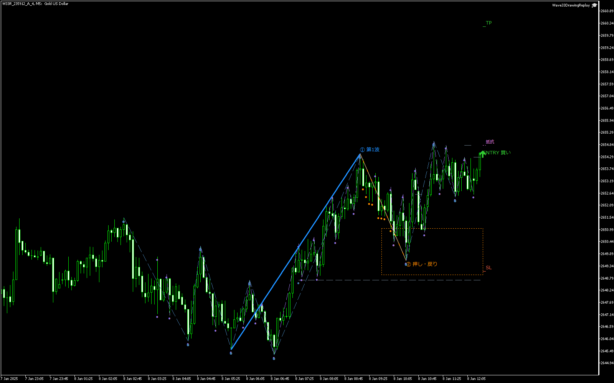

# v1.20 水平線の終了管理と過去データでの売買

2026-10-20～21。ユーザーの「水平破線が右へ伸び続け、時間とともに増えて見づらい」という指摘を反映し、過去の線は当時の区間に残す有限線へ変更した。既存のテスター発注機能には注文ON専用プリセットを追加した。エントリー条件・リスク計算は変更していない。

## 変更後の動作

- 上位ブレイク線・下位の転換線・Fib帯：候補の監視中だけ延ばし、シグナル・見送り・失効で止める。
- 診断だけのSL・TP・抵抗線：表示足1本分の短い線。
- 発注後のSL・TP・抵抗線：実ポジションの決済またはテスト終了で止める。部分決済では継続する。
- 全ての線は無限の左／右延長なし。山谷の連結・W1・W2・過去の失効理由は残す。任意の手動水平線も下位足12本分の有限表示とする。

延長は観測済みのイベント時刻まで。生成直後や同時刻終了では、線が潰れないよう表示足1本分のマーカーを使う。価格の未来データを取得する処理ではない。終了済みの線を、後から届いたPOSITION_TRACKING通知で再開しないことも検証した。

上の画像は通常MT5チャートの**記録イベント再生**。実XAUUSDの判断時刻までのバーと元CSVを使用する。ネイティブのテスター画面を直接撮影したものではなく、注文も再計算しない。

## 実際のMT5バックテスト注文

更新EA：[Wave33VisualVerifier.ex5](../../../../mql/Experts/Wave33VisualVerifier.ex5)。操作は [注文ONの手順](../../../../docs/validation/wave33-tester-orders.md) を参照。通常の診断用プリセットは注文OFFのまま保全した。

|パターン|チャート時間足|専用設定|今回の約定／決済|
|---|---|---|---|
|M15×M5|M5|[A 注文ON](../../../presets/wave33-v1-A-M15-M5-orders.set)|4 / 4（SHORT 4）|
|M5×M1|M1|[B 注文ON](../../../presets/wave33-v1-B-M5-M1-orders.set)|24 / 24（LONG 15 / SHORT 9）|

XAUUSD、2025-01-06～2025-01-18、Model4（real ticks）、証拠金10,000 USD、リスク1%、RR1.0。上の約定・決済は**ネイティブのMT5ストラテジーテスター**で発生した注文記録である。今回の自動注文スモークは非ビジュアル実行。ユーザー用の専用INIはVisual=1。通常口座での発注は禁止する既存ガードを維持する。

## 確認結果

- [最終バッチ](../20261020_235907_9a0d8776/review.md)：描画ハーネス・A診断・A注文・B注文の4実行が監査PASS。
- [描画ハーネス](../20261020_235907_9a0d8776/display_harness/review_cases.md)：19/19 PASS。候補の独立、既知時刻からの開始、シグナル停止、診断短線、発注中の保持、決済停止、遅配通知、終了の重複、斜線の失効を実オブジェクトで確認。
- [最終EAコンパイル](../20261020_235907_9a0d8776/Wave33VisualVerifier.compile.log)：0 errors / 0 warnings。描画ハーネスと描画再生補助EAも0 errors / 0 warnings。
- [A注文ログ](../20261020_235907_9a0d8776/a_orders_smoke/events.csv)、[B注文ログ](../20261020_235907_9a0d8776/b_orders_smoke/events.csv)：ORDER/FILL/EXITはそれぞれ4/4/4、24/24/24。
- [不変監査](audit.json)：Engine・Types・Ledger・参照インジケーターのSHA-256は不変。A診断の全1499行は初版とバイト一致。遅配対策前後でもA/B注文イベントはバイト一致。
- [描画オブジェクト監査](drawing_audit.json)：4画像の391線すべて左右ray=0。パネル0。画像原本とオブジェクトCSVは [A](drawing_review/A/render_summary.csv) / [B](drawing_review/B/render_summary.csv) に紐付ける。

その他の表示：[A SHORT](drawing_review/A/W33R_0BD153B5808FF0E9_1.png)、[B SHORT](drawing_review/B/W33R_0871E451FE5A8729_4.png)、[B TIMEOUT](drawing_review/B/W33R_0B71E90ACF47B8E8_1.png)。

ユーザーの動画との一致、通年成績、収益性、運用昇格は今回の判定対象にしていない。今回確認したのは、描画の終了管理と、過去データでの発注・約定・決済が実行されること。
