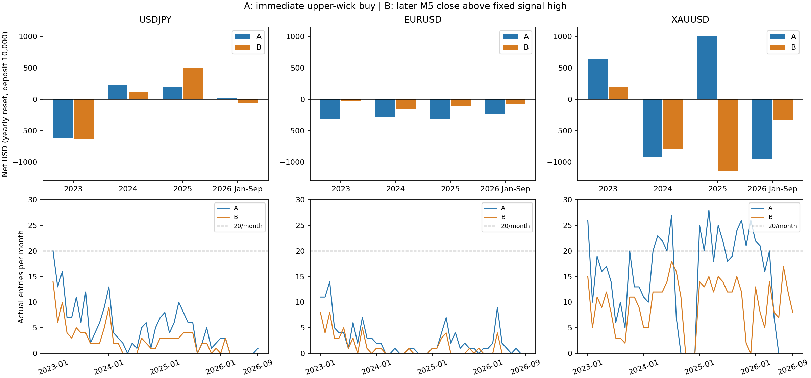

# 上ヒゲ即時A／終値再突破B：全期間検証の結論

**全34本の監査は合格。ただしBは採用しない。固定高値を終値で再突破してから買う変更は、複数年で安定した正期待値を作れなかった。**

対象はM5 Round LONG。過去のM1/M5「3の3 READY」EAとは別系統。売買EA・既存Sharedは変更していない。

## 1. 何を比較したか

- A：条件を満たした上ヒゲM5足の確定後、最初のAskで買う。
- B：同じ足のHighを固定し、後続M5の終値が初めて上抜いた時に買う。待機18本、固定pivot low割れで無効。
- 共通：Entry時ATR14×2.2のSL、TP1.5R、リスク予算Equity0.65%、1ポジション、日次2取引、日次損失3%、DD12%、spread/ATR上限0.2。
- SL/TPは各Entry時のATRで再計算される。同じ絶対SL/TP・同じ出口時刻を固定した純粋な入口価格だけの比較ではない。
- 2023〜2025各年＋2026年1〜9月、USDJPY/EURUSD/XAUUSD。Vantage、生成tick、既知期間。最適化なし。

## 2. 実行可能リプレイの結果

年ごと・銘柄ごと・A/Bごとに初期10,000 USDへ戻した独立口座の合算。以下のPFは全実取引の利益合計÷損失絶対額で再計算し、年別PFの平均ではない。合成portfolioや45か月連続複利の成績ではない。

|symbol|arm|n|net|pf|win_rate|mean_fill_r|entries_per_month|months_at_least_20|
|---|---|---|---|---|---|---|---|---|
|EURUSD|A|119|-1169.080|0.657|0.412|-0.152|2.644|0|
|EURUSD|B|59|-373.880|0.755|0.441|-0.098|1.311|0|
|USDJPY|A|227|-190.470|0.969|0.476|-0.009|5.044|1|
|USDJPY|B|116|-75.300|0.975|0.474|-0.009|2.578|0|
|XAUUSD|A|667|-237.420|0.987|0.444|-0.009|14.822|19|
|XAUUSD|B|432|-2090.690|0.829|0.442|-0.081|9.600|0|

mean_fill_rは価格損益R。net/PFには実際のswap等を含む。全runのcommission/feeは0、XAUUSD Aにswap −21.68 USDを含む。

- USDJPY：A/Bとも全期間PF<1。Bの改善は主に2025年29取引に依存。2025年のBはPF2.001・+498.12 USDだが、2023年は−628.69 USD、2026年は3取引のみで−62.49 USD。
- EURUSD：Bで損失は縮小したが、全ての年で実損益が負。回数も119→59と半減し、正期待値には至っていない。
- XAUUSD：Aの全期間−237.42 USDに対してBは−2,090.69 USD。2025年はA +1,001.85 USD、B −1,155.62 USDへ悪化。
- 単独で毎月20回を満たす案はない。最も多いXAUUSD Aも月平均14.82回、45か月中20回以上は19か月。Bは全銘柄とも20回に届いた月が0。

## 3. 全候補shadow：口座制約を外しても改善したか

全元候補4,476件、B成立2,358件。候補があってもB未成立なら仮想損益0には置換しない。SL/TP両方に触れた決済分の7shadowは主評価から除外。口座リプレイの実取引を後から削除した結果ではない。

|symbol|arm|base_candidates|n_evaluable|win_rate|expectancy_r|pf|
|---|---|---|---|---|---|---|
|USDJPY|A|1666|1664|0.404|-0.126|0.756|
|USDJPY|B|1666|898|0.369|-0.174|0.681|
|EURUSD|A|1408|1406|0.361|-0.200|0.642|
|EURUSD|B|1408|703|0.385|-0.144|0.732|
|XAUUSD|A|1402|1401|0.436|-0.023|0.950|
|XAUUSD|B|1402|755|0.419|-0.110|0.780|

shadowは観測Ask/Bidのspreadを含む価格損益Rで、commission/swapは含まない。BはEURUSDで平均Rが改善したが依然負、USDJPY/XAUUSDでは悪化した。

## 4. 確認待ちで何を失ったか

|symbol|raw_candidates|b_formed|a_losses_without_b|a_wins_without_b|entry_worse_mean_a_r|wait_median_minutes|
|---|---|---|---|---|---|---|
|EURUSD|1408|703|611|92|0.551|15.000|
|USDJPY|1666|900|635|129|0.512|15.000|
|XAUUSD|1402|755|527|120|0.508|15.000|

B未成立はAの損失を1,773件避ける一方、Aの利益341件も取り逃した。重要なのは、Bが成立したケースでも平均0.51〜0.55 A-R高い価格で買い、待ち時間中央値15分だったこと。

|symbol|paired_evaluable|paired_a_mean_r|paired_b_mean_r|a_profit_to_b_loss|a_loss_to_b_profit|b_to_a_risk_width_mean|
|---|---|---|---|---|---|---|
|EURUSD|701|0.294|-0.141|156|15|0.997|
|USDJPY|897|0.294|-0.173|224|12|0.980|
|XAUUSD|754|0.423|-0.108|179|5|0.978|

両案成立・両案評価可能な同一候補では、B−AはUSDJPY −0.468R、EURUSD −0.436R、XAUUSD −0.531R。週単位block bootstrapでも2023〜2024／2025〜2026の両区間で負だった。
ただし「B成立を後で知った候補だけのA」は未来条件で選ばれた説明用部分集合であり、当時実行可能な新しいAフィルターの成績ではない。差にはEntry価格だけでなくATR/SL幅・出口時刻の変化も含む。

## 5. 回数を減らした要因

Aの全候補に対し、spread見送りはUSDJPY 1,336/1,666（80.2%）、EURUSD 1,255/1,408（89.1%）。ゴールドはspread 144件より日次回数制限165件、口座DD停止286件、保有中140件も大きい。
記録は最初に返った見送り理由なので、複数制限の同時成立を排他的な真因として数えたものではない。
全shadowの期待値も負で、spread制限だけを緩めれば収益性が解決するという証拠にはならない。損失縮小が取引削減から来ただけか、平均R/PFも併読する。

## 6. M15/H1/H4環境と年別再現性

事前に決めた6種類（H1方向/M15位置/H4方向、それぞれEntry時と共通A発生時）の全カテゴリを年別に確認した。4期間全てで正のshadow平均Rとなるカテゴリはなかった。AND探索・閾値探索は行っていない。
例：XAUUSD A・共通A時点H4 RANGEは2023 +0.115R、2024 +0.045R、2025 +0.055Rだったが、2026は−0.155R。H1 RANGEも2026に負へ反転。
M15 LOWには年2〜8件の小さい区分があり、良い年があっても採用根拠にしない。カテゴリを除外した後の口座経路は今回は実行しておらず、全shadow区分の成績を実行可能成績と混ぜない。
同一親を共有する反復候補がある。親数・週block区間を保存したが、個々の候補が独立した証拠だとはみなさない。

## 7. 大勝依存・執行上の観測

最大利益取引を除いても、USDJPY Bの2025年は+398.08 USD、XAUUSD Aの2025年は+896.19 USD。良い年が1件の異常利益だけで作られたわけではない。問題は他年への再現性と低頻度。年別の詳細はactual_yearly.csv。
リスクplanは全て予算内だが、SLが指定価格で約定する保証ではない。USDJPY Bの2023-08-11はSL144.638に対して実決済144.408、−2.144R（−134.31 USD）。SLより下のBidでの決済がAsk/Bid/約定ログに記録されており、想定riskの計算超過と区別する。
18本のM5保有は通常90分相当だが、休場・tick不在時には壁時計90分で決済できない。XAUUSD Aの2025-11-27 20:10→翌01:09:26の取引は4.99時間となり、swap −21.68 USDが付いた。売買ルールは今回変えていない。
real ticksの検証ではない。注文遅延0、追加commission0のtester条件であり、既知期間の結果から未使用OOSやliveでの優位性を主張しない。

## 8. 監査の結論と次の判断

34/34 run合格。新規30本＋修正後r2から再監査付き再利用4本。履歴期間監査33本、旧版reference/A一致3組、A/B候補・shadow・環境一致15組、MQL harness 15項目。
過去とのswap仕様差7runはenvironment_exact=falseのまま記録。適用swap0・日内買い・約定/cash/判断CSV完全一致の限定分類であり、現在のA/Bペアの環境差を許したものではない。3ソースのcompileは0 errors / 0 warnings、Python34テスト合格。
**採否：Bを本番へ反映しない。この固定入口仮説は区切りをつけ、RR・待機本数・spread上限を利益に合わせて追加探索しない。Aも今回の全期間で正期待値を示しておらず、本番昇格の根拠にはしない。**
本番EAを変更せず、このサイクルを終了する。別の仮説に進む場合も、今回の有利な年だけを選ぶのではなく、新しい予測理由と未使用期間を先に固定する。

## 成果物

- [年別実行結果](actual_yearly.csv) / [全期間実行結果](actual_overall.csv)
- [選別・価格悪化・遷移](candidate_transitions.csv) / [実行見送り理由](execution_blockers.csv)
- [環境区分の再現性](context_stability.csv) / [全環境区分](../context_statistics.csv)
- [全4,476候補×A/B](../candidate_comparison.csv) / [月別実行数](../monthly_execution.csv)
- [両案成立例の週block区間](../paired_uncertainty.csv) / [過去環境の差](../historical_environment_differences.json)
- [機械可読な採否](verdict.json) / [入力証拠のhash](provenance.json)
