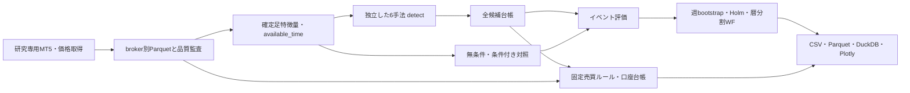

# Phase 3 アーキテクチャ

## 処理の境界

シグナル抽出は将来の価格、TP/SL結果、観測完全性を参照しない。イベント評価が付けるcompleteは研究の観測マスクで、口座シミュレーターにフィルターとして渡さない。欠損を跨ぐ未解決建玉は勝手に決済・リセットせず口座の後続経路を打ち切る。

## 単位と時刻

各バーは `time`（始値の時刻）、`close_time`（名目確定）、`available_time`（利用可能時刻proxy）を持つ。MT5履歴取得は名目確定をproxyとしており、実際の最初のtick到来を計測した値ではない。上位足はavailable_timeで後方asof結合し、未確定足を参照しない。

候補は `signal_time` と `entry_time`、両index、確定時ATRを別々に持つ。シグナル確定後の最初の観測始値を約定proxyとし、名目確定から1時間足分を超えた場合は失効。

pips: USDJPY=0.01、他5通貨=0.0001。pointとtick sizeはMT5メタデータ。MFE/MAEとリターンはsignal ATRで正規化する。H10はエントリー足を含む10本で、M5=50分、M15=150分、H1=10時間。**時間足間で物理的な保有時間が同じわけではない。** 比較する対照は必ず同じ通貨・同じ時間足・同じH。

USD口座損益は、quote currencyがUSDならそのまま、USDJPY/USDCHF/USDCADなら出口時点の同一ペア価格の逆数で換算する。現時点のtick valueを過去へ流用しない。brokerの歴史的仕様が不明なため実ブローカーの約定損益との完全一致は主張しない。

## 拡張インターフェース

- `build_features(bars, timeframe, symbol, spec, config, auxiliary)` は将来非依存の指標・環境。
- `detect(features)` はLONG/SHORTのbool mask。手法間で別の実装ファイル。
- `extract_candidates` は原候補を全件保存。`comparison_eligible` は後段の統計比較だけで使用。
- `evaluate` は既存エンジンへstep/pip/point/costを明示。全観測期間でMFEとMAEの長さを一致。
- `random_controls` は原候補との対応ID、反復、抽出条件を保存。無復元はセル/反復/層ごと。反復間重複は許容し独立標本と数えない。
- `simulate` は1通貨/手法/方向の独立口座。LOT・SL/TP・保有期限・約定proxy・曖昧順序・重複・失効を持つ。ポートフォリオを暗黙に合算しない。

## 研究の管理

設定と事前計画を結果計算前に固定。全216セルを履歴として残し、正のものだけを出力しない。条件付き対照でボラ環境を一致させると収縮そのものの効果を消し得るため、無条件との差も併記する。648仮説のHolmは任意の相関を許容し、全市場のbootstrapは同じカレンダー週重み。週を跨ぐ依存を完全解決したとは言わない。

WFは2024H2/2025H1/2025H2、固定ルールを全区間で評価。signalからラベル終了までの区間に基づきpurgingし、train末尾には最大H50×H1=180000秒のembargoを置く。パラメータを学習しないため、将来ルール選択を追加するときには**各foldのtrain内で選択を完結する別プロトコル**が必要。現在の結果を新規独立OOSと呼ばない。

## 保存・再現

価格はbroker/server付きmanifestとSHA256。runはソースhash・Git HEAD・dirty状態・依存バージョン・全設定・seed・入力hashを保存。新しいrun先への再実行だけを許可する。DuckDBには集計tableと保存済みParquetを参照する候補/アウトカム/対照/取引viewを作る。別ディレクトリに移動した場合は絶対パスviewを再構築する。

HTMLはPlotlyを内包する。旧研究は読み取りとhash検証だけで保護する。研究端末の接続情報は機械ローカルに留め、レポートにはbroker/serverと価格仕様のみ出力する。テスター用fixtureは発注APIを一切呼ばず、実約定・収益性とは別のQA証拠にする。

## 現時点の未実装・未検証

- 実tickによる曖昧順序の解消、実Bid/Ask約定、実commission/swap、歴史的margin/仕様。
- 取引カレンダーによる休場と真の欠損の完全な区別、未解決建玉を含めた通年口座経路。
- 複数通貨の同時ポジション、共通USD曝露、証拠金・portfolio kill switch（Stage3）。
- 2026を使わない独立将来期間評価（Stage5）。

これらが解消するまで、統計的な仮説候補を運用可能戦略へ昇格しない。
